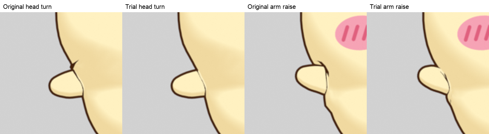

# 030：骨骼与蒙皮问题调研

调研日期：2026-11-17；代码基线：`522d07d`。本目录是研究证据，未修改模型、流水线或应用代码。

## 结论

**②转头时手上方鼓起、⑤抬手时头侧皱缩，主要来自臂根权重分区误覆盖头部下侧，以及分区边界的权重突变。** 不是 Neck/Shoulder 两组相互混权：当前 VRM 中这两类骨骼的直接权重均为零。`rig_usagi.py::regions()` 把一个宽度、高度、深度都用硬条件截断的区域归为手臂；`geometry_weights()` 在这个区域完全删除正常躯干中的 Head 权重，用 Chest 与臂链替代。转头时这片头侧被留在原地，抬手时它又跟手臂走，于是形成镜像的尖角与凹折。

**④手脚看起来不动，主要是动作设计：很多动作只移动/缩放整个角色；Hand/Foot 没有直接动画；走路摆臂仅 ±0.025 rad，且接近绕臂长轴扭转。** 末端蒙皮跟随很强，不支持“骨骼动了，但末端权重太弱”的解释。腿确实在走路/坐下时被驱动，不过走路角度小、主要沿前后方向摆，在正面容易被整体摇摆盖过。

“头部皱缩”在本次复现中具体发生于**手上方的下脸/头侧接缝**。单独抬臂时，Z≥0.31676 的上部头壳没有位移；没有证据证明上臂能直接拉坏头顶。伸展/喊叫还会转 Chest，Head 作为后代会整体随之运动，不能把这种正常整体位移当作头顶缩小。



图依次为：转头原权重、转头试验权重、抬臂原权重、抬臂试验权重；四格使用相同裁剪框。试验减轻了尖角/凹折，仍有细小接缝，不能当作已完成的修复。

## 方法、模型与可核对的数据

- 输入仅为 `assets/models/usagi.vrm`，SHA-256：`58b0aa074e02877856ea7b6bcc5ed0b706c0af4ff86b35c19224c9ac0b8b8b4d`；源产物 `assets/model/usagi.vrm` 与部署模型的相等性另见本次自查。
- 直接解包 GLB JSON/BIN，读取 `POSITION`、`JOINTS_0`、`WEIGHTS_0`，按 skin.joints 解析骨名；不从旧 rig 报告推断当前权重。旧报告另外确认当前构建走 `geometry` 回退，自动热量权重未获采用。
- 共 20,471 个 accessor 顶点：身体（含耳、尾）19,697；眼贴片 631；嘴贴片 143。身体按坐标四舍五入到 1e-7 后有 19,184 个位置；统计**不焊接接缝拆点**。单点最多 3 个影响，最大归一化误差 `1.0431e-7`。
- 本文几何统计使用 **Blender 坐标，X 左右、Y 后方、Z 向上，单位米**；角色左侧为 +X，正面为 -Y；模型中性高度 H≈1。动作表使用程序的 **VRM normalized 坐标：Y 向上、+Z 朝前，角度单位 rad**。动作 Y 转头映射为 Blender Z 旋转；动作 Z 抬臂映射为 Blender -Y 旋转。
- 使用实际 `three@0.187.0`、`@pixiv/three-vrm@3.5.5` 在 Node 中加载模型、设置 normalized 骨骼并取得 CPU 蒙皮；省去材质/表情解析，关闭弹簧，保留原位置/权重/逆绑定矩阵与骨架。随后把得到的 raw 骨骼世界矩阵送入 Blender，而不是直接把 normalized Euler 数值写到 Blender bone 的本地 Euler 轴。
- Blender 5.2.3 LTS，无头 VRM 插件导入，调用项目 `face_usagi.py::preserve_source_rest_pose()` 恢复输入 rest frame；关闭保体积蒙皮，使用线性蒙皮。九个姿势、每姿势全部 19,697 个身体顶点，与 three-vrm 的最大位置差均 <`2.8e-7 m`。这排除了本次图像由 Blender 骨轴误用造成的可能。
- 正面与 45° 机位固定，正交尺度 1.22，原图 640×640。45° 机位另有轻微俯角。原材质图使用 Eevee、原 MToon 节点和真实描边；热图使用无光照顶点色、隐藏五官贴片与描边。热图颜色：蓝 0、青 0.25、绿 0.5、黄 0.75、红 1。

详细数字见 [weight-measurements.json](weight-measurements.json) 与 [pose-measurements.json](pose-measurements.json)。前者含逐骨包围盒、各区域统计及 19 条突变边的端点坐标/权重，后者含逐姿势蒙皮对照误差与末端位移。

## 权重体检

### 逐骨统计

以下阈值严格为 **weight >0.05**；包围盒包括所有网格，因此 Head 一行包含五官贴片。包围盒记为 `[X,Y,Z] 最小 → 最大`，保留 4 位小数；“—”表示没有达到阈值的顶点。零权重并不代表骨骼不产生作用：Neck 仍通过父子层级带动 Head，Shoulder 仍是臂链父骨。

| 骨骼 | 顶点数 | 包围盒（m） |
| --- | ---: | --- |
| Hips | 1,125 | [-0.2509, -0.2000, 0.0576] → [0.2509, 0.2074, 0.1988] |
| LeftUpperLeg | 272 | [0.0056, -0.1004, 0.0342] → [0.1727, 0.1165, 0.0928] |
| LeftLowerLeg | 168 | [0.0056, -0.1170, 0.0156] → [0.1116, 0.0359, 0.0904] |
| LeftFoot | 92 | [0.0266, -0.0305, -0.0000] → [0.0926, 0.0296, 0.0474] |
| RightUpperLeg | 267 | [-0.1688, -0.1004, 0.0327] → [-0.0085, 0.1165, 0.0928] |
| RightLowerLeg | 166 | [-0.1063, -0.1170, 0.0156] → [-0.0085, 0.0359, 0.0904] |
| RightFoot | 92 | [-0.0833, -0.0305, 0.0000] → [-0.0173, 0.0300, 0.0474] |
| Spine | 557 | [-0.2509, -0.2211, 0.1475] → [0.2509, 0.2269, 0.2799] |
| Chest | 1,196 | [-0.3119, -0.2357, 0.2091] → [0.3119, 0.2728, 0.3537] |
| LeftShoulder | 0 | — |
| LeftUpperArm | 629 | [0.2386, -0.0979, 0.2091] → [0.3070, 0.0979, 0.3166] |
| LeftLowerArm | 392 | [0.2753, -0.0955, 0.2345] → [0.3344, 0.0628, 0.3166] |
| LeftHand | 186 | [0.3124, -0.0349, 0.2379] → [0.3466, 0.0232, 0.2907] |
| Neck | 0 | — |
| Head | 6,862 | [-0.3280, -0.2861, 0.1492] → [0.3280, 0.2924, 0.7462] |
| EarL_1 | 2,390 | [0.0064, -0.0491, 0.7203] → [0.1185, 0.0364, 0.8122] |
| EarL_2 | 2,001 | [0.0073, -0.0491, 0.7594] → [0.1194, 0.0364, 0.8837] |
| EarL_3 | 2,226 | [0.0100, -0.0491, 0.8315] → [0.1194, 0.0354, 0.9536] |
| EarL_4 | 2,296 | [0.0169, -0.0459, 0.9018] → [0.1150, 0.0308, 1.0000] |
| EarL_Tip | 0 | — |
| EarR_1 | 2,371 | [-0.1185, -0.0491, 0.7203] → [-0.0064, 0.0364, 0.8128] |
| EarR_2 | 1,989 | [-0.1190, -0.0491, 0.7594] → [-0.0073, 0.0364, 0.8837] |
| EarR_3 | 2,230 | [-0.1190, -0.0491, 0.8315] → [-0.0100, 0.0354, 0.9539] |
| EarR_4 | 2,308 | [-0.1150, -0.0459, 0.9018] → [-0.0166, 0.0308, 1.0000] |
| EarR_Tip | 0 | — |
| RightShoulder | 0 | — |
| RightUpperArm | 631 | [-0.3070, -0.0979, 0.2091] → [-0.2391, 0.0979, 0.3166] |
| RightLowerArm | 393 | [-0.3344, -0.0955, 0.2345] → [-0.2753, 0.0628, 0.3166] |
| RightHand | 186 | [-0.3466, -0.0349, 0.2379] → [-0.3124, 0.0232, 0.2907] |
| Tail | 353 | [-0.0330, 0.1722, 0.1695] → [0.0379, 0.2499, 0.2399] |
| TailTip | 0 | — |

### 头部和臂根的交叉影响

关键点：手臂根部 Z=`0.2617585`；Head 起点 Z=`0.3617585`；耳根/头顶分界 Z=`0.7155062`；手臂掩码横向门槛 `|X|>0.2317401`，高度上界 Z=`0.3167585`，深度门槛 `|Y|<0.10`。

为了避免拿生产掩码证明生产掩码正确，分三档报告，并明确它们的局限：

| 独立取样区域（身体顶点，排除五官贴片） | 点数 | 臂骨总权重 >0.05 的点数 | 含义 |
| --- | ---: | ---: | --- |
| 广义头下侧：`0.2767585<Z<0.7155062` | 3,316 | 616（18.58%） | 包含小手自身上缘，不能把全部 616 点都叫误分 |
| 高于实际手端的下头侧：`0.300<Z<0.7155062` | 2,704 | 114（4.22%） | 当前手端样本最高仅 Z=0.28725；这里仍出现近 100% 臂链权重 |
| 高于生产臂掩码：`0.3167585≤Z<0.7155062` | 2,526 | 0 | 说明错误局限于头部下侧，不是整颗头都混进手臂 |

广义头下侧逐组的 `>0.05` 点数 / 最大权重：

| 骨骼 | 左侧 | 右侧 |
| --- | --- | --- |
| Shoulder | 0 / 0 | 0 / 0 |
| UpperArm | 251 / 0.995573 | 255 / 0.995573 |
| LowerArm | 211 / 1.000000 | 212 / 1.000000 |
| Hand | 41 / 0.999133 | 41 / 0.999133 |

各行有重叠，不能相加作为受影响的总点数。

“手臂根部上方一圈”取 `0.2767585<Z<0.3517585`、`|X|>0.2317401`、`|Y|<0.10`，共 **664 点**：Head `>0.05` 为 **48 点**、最大 **0.843523**；Neck **0 点**；Chest **137 点**、最大 **0.635859**。其中 616 点受臂链明显影响，头/胸影响并不是均匀连续地分摊，而是在掩码边缘切换。

可定位的实际网格边（Body primitive 0，顶点索引均为该 primitive 的 accessor 索引）：

- 顶点 6211：`(-0.281632, 0.082804, 0.316561)`，RightUpperArm=`0.984275`、RightLowerArm=`0.015725`、Head=`0`。
- 相邻顶点 6230：`(-0.290914, 0.085735, 0.333659)`，Head=`0.646806`、Chest=`0.353194`，无臂链权重。
- 两点距离 `0.019675H`，Head 权重跨越 `0.646806`。同一区域共有 **19 条拓扑边**跨越超过 0.5 的 Head 权重差。这是可定位的权重不连续证据，不是仅凭颜色判断。

### 手、脚末端

手端采样：本侧 `|X|≥rootX+0.75×(tipX-rootX)`，`|Z-rootZ|<0.055`，`|Y|<0.10`。脚端采样：`Z<0.03` 且本侧 `0.005<|X|<0.14`。这些是明确的局部末端样本，不是所有解剖手/脚顶点。

| 区域 | 点数 | 主要权重均值 | 次要权重均值 | 末端骨 >0.05 点数 / 最大权重 |
| --- | ---: | --- | --- | --- |
| 左手端 | 137 | LeftHand 0.881712 | LeftLowerArm 0.118288 | 137 / 1 |
| 右手端 | 137 | RightHand 0.880796 | RightLowerArm 0.119204 | 137 / 1 |
| 左脚端 | 79 | LeftFoot 0.898127 | LeftLowerLeg 0.101868 | 77 / 1 |
| 右脚端 | 79 | RightFoot 0.897259 | RightLowerLeg 0.102736 | 77 / 1 |

手端不直接分给 UpperArm、脚端很少直接分给 UpperLeg，**符合子链继承**：旋转上臂会移动 Hand 及其网格，旋转大腿也会移动 Foot。不能只看“直接 UpperArm 权重为零”便判定手不会跟着上臂动。

### 热力图索引

每格为一张独立、带图例的热图。Side 从角色左侧 +X 看；全零的 Neck/Shoulder 也保留。

| 骨骼 | 正面 | 侧面 |
| --- | --- | --- |
| Head | [Head-front.png](weights/Head-front.png) | [Head-side.png](weights/Head-side.png) |
| Neck | [Neck-front.png](weights/Neck-front.png) | [Neck-side.png](weights/Neck-side.png) |
| Chest | [Chest-front.png](weights/Chest-front.png) | [Chest-side.png](weights/Chest-side.png) |
| 左 UpperArm | [LeftUpperArm-front.png](weights/LeftUpperArm-front.png) | [LeftUpperArm-side.png](weights/LeftUpperArm-side.png) |
| 左 Shoulder | [LeftShoulder-front.png](weights/LeftShoulder-front.png) | [LeftShoulder-side.png](weights/LeftShoulder-side.png) |
| 左 UpperLeg | [LeftUpperLeg-front.png](weights/LeftUpperLeg-front.png) | [LeftUpperLeg-side.png](weights/LeftUpperLeg-side.png) |

Head 权重低端一直延伸到 Z≈0.1492，这是脸保护球及 0.12 米径向过渡的结果，不能简单全部改成只按高度分配，否则可能重现旧颈部/腰线折痕。LeftUpperArm 热图则清楚显示臂根向头下侧延伸、在边缘突然结束。

## 截图复现与因果分离

用户原图：[手上方鼓起](../用户反馈-1117/手上方鼓起.png)、[头部皱缩-抬手](../用户反馈-1117/头部皱缩-抬手.png)。原图没有角度、状态与安装包模型哈希，因此这里只复现同类局部变形，不声称逐像素还原当时姿势。

### Head 的四个单轴姿势

[head-rotations.png](poses/head-rotations.png)：每行从左到右为中性、Head Y=-0.4、Y=+0.4、X=-0.25、X=+0.25；上行为正面，下行为 45°。其余骨骼均中性，弹簧关闭。

Y 转头可见手上方尖角/下头侧折线，正负方向互为镜像；X 俯仰改变下脸与身体的相接形状，45° 图更容易看到。不是手端跟头一起运动：原权重的手端位移仍 <`2.2e-7H`，而上部头壳最大位移约 `0.1308H`（Y）或 `0.0890H`（X）。**头侧一片顶点被错误地“固定”在臂区，周围头壳转走，导致局部鼓起/牵扯。**

### 最大抬臂

[arm-raise.png](poses/arm-raise.png)：从左到右为中性、仅手臂、手臂+Chest。

- 上臂：左 normalized Z=+0.43，右=-0.43；前臂：左 Z=-0.10，右=+0.10；Shoulder、Hand 都为 0。这是当前 `ARM_REST+ARM_RAISE` 最大值，不是旧版 0.75 或 1.1 rad。
- “手臂+Chest”再加 Chest X=-0.10，对应伸展/喊叫的骨骼部分。为隔离变形，**图中不加程序的 hipsY=0.025H 整体抬升**，也不叠加呼吸和根节点变换。
- 仅抬臂就复现两侧下头部凹折；采样头侧带（`0.300<Z<0.3167585`、`|X|>0.23174`、`|Y|<0.10`，114 点）最大位移 `0.026328H`，平均 `0.021062H`。同一姿势高头壳 2,526 点位移为 0。
- 原权重手端最大位移 `0.033410H`，垂直抬升最大 `0.032850H`。实际伸展还加 hipsY、Chest，所以不能用本图的局部抬升直接代替应用已有“手高 >0.05H”测试。
- 加 Chest 后高头壳最大位移 `0.045584H`，包含父骨刚性运动；头侧带最大 `0.028747H`。这解释了实际动作为什么比单独扳臂复杂，不能据其位移宣称整颗头被臂权重缩小。

### 与真实注视范围的关系

`behaviors/look.ts:20–34` 给 Head/Neck 各分配 yaw±π/18、pitch±π/36，总 yaw±20°、pitch±10°；在 idle 中 `motion/index.ts:133` 还会叠加 lookAround 的 Head yaw±0.12。yaw 同向叠加可接近 **0.4691 rad（26.9°）**，大于单个 Head 的 ±0.4 实验范围，但绕 Neck 与 Head 的枢轴不同。

[gaze-walk.png](poses/gaze-walk.png) 中 Gaze 一列专门复现 Neck yaw=0.174533、Head yaw=0.294533 的同向组合。仅压低单骨转头角度可能掩盖问题，不能消除臂区硬边界。

“鼠标移动看过来”和“抓住整只宠物拖动”应分开：前者走 idle 注视链，后者 `renderer/index.ts:276–278` 固定采样 drag 姿势，通常不再应用 idle 注视；它也会经上臂动作扯动同一错误分区。不能把所有鼠标相关现象都归到 lookAt。

## 手脚动作表与“看起来不动”的原因

来源：[motion/index.ts](../../../app/src/renderer/motion/index.ts#L19)、[motion/food.ts](../../../app/src/renderer/motion/food.ts#L15)、[behavior/machine.ts](../../../app/src/renderer/behavior/machine.ts#L24)。以下为每侧骨骼的**局部 normalized 旋转**。`L/R` 为左/右；未列出的四肢关节均未直接驱动；全体动作均没有直接 Hand/Foot 旋转。有限动作乘以 0.18 秒 smoothstep 入/出包络，表中列包络内的峰值或范围，不表示角度一开始就跳到峰值。

| 动作 | 上臂 UpperArm | 前臂 LowerArm | 大腿 UpperLeg | 小腿 LowerLeg | 持续时间 / 为什么可能不显眼 |
| --- | --- | --- | --- | --- | --- |
| idle / lookAround | 无 | 无 | 无 | 无 | 每段 3.5 s；只有根部轻摇、头部注视，四肢本就不单独动 |
| turn | 无 | 无 | 无 | 无 | sampler 默认 0.9 s，实际状态机转身 0.45 s；只转根节点 |
| walk | L X=−0.025s，R X=+0.025s | 无 | L X=+0.16s，R X=−0.16s | L X=0.12max(0,−s)，R X=0.12max(0,s) | 默认 2 s，实际为路程/90 DIP·s⁻¹；小角度、手臂近轴向扭动、腿主要前后摆 |
| drag | L Z=−0.16+0.05v，R Z=+0.16+0.05v | 无 | L X=+0.035，R X=−0.035；两侧 Z=0.04v | 无 | sampler 1.2 s；实际进入后停在 t=0.5 s，持续抓住即持续保持，不循环摆动 |
| stretch | L Z=+0.43，R Z=−0.43 | L Z=−0.10，R Z=+0.10 | 无 | 无 | 2.2 s；有抬臂，但主要是平台期姿势，头侧权重错误限制了可用幅度 |
| shout | 同 stretch | 同 stretch | 无 | 无 | 1.3 s；同上 |
| napPillow | 两侧 X=0.08；L Z=+0.06，R Z=−0.06 | 无 | 无 | 无 | 4 s 循环；循环时 w=1，手臂保持小角度，不随呼吸来回摆 |
| jumpRope | 两侧 X=±0.06，**同相**正弦 | 无 | 无 | 无 | 6.5 s；1.2 s 后六圈，每圈 0.6 s；手臂主要扭动，跳跃靠根节点位移/缩放，没屈膝/抬脚 |
| eatRiceball | L Z=+0.20，R Z=−0.20 | 无 | 无 | 无 | 6 s；开头抬起后保持，道具沿自身轨迹，不跟手作 IK |
| eatWatermelon | 同上 | 无 | 无 | 无 | 5 s；同上 |
| iceCream | 同上 | 无 | 无 | 无 | 5.5 s；另有头/胸动作，手部没有跟随舔食逐次运动 |
| sneakSnack | 同上 | 无 | 无 | 无 | 4.5 s；手只作一次轻抬，饼干独立移向嘴 |
| caught（偷吃被发现） | 冻结在抓到瞬间的 sneakSnack 角度 | 无 | 无 | 无 | 状态持续时不推进姿势时间，刻意不再摆动 |
| blowBubbles | 无 | 无 | 无 | 无 | 5 s；只有头/胸和泡泡/道具，四肢未驱动 |
| jump / happy | 无 | 无 | 无 | 无 | 各 1.2 s；整体跳起和落地压缩，未加四肢关节动画 |
| shake | 无 | 无 | 无 | 无 | 1.2 s；只摇 Head（yaw±0.38、roll±0.18），四肢未驱动 |
| spin | 无 | 无 | 无 | 无 | 1.8 s；只根节点转一圈 |
| surprised | 无 | 无 | 无 | 无 | 1.1 s；根节点退缩/缩放、Head 俯仰 |
| perchHop / perchDown | 无 | 无 | 无 | 无 | 1.04 / 0.72 s；只压缩与落地，跳台位移另由窗口层控制 |
| sit（坐边缘叠层） | 无 | 无 | 两侧 X=−1.2 | L X=0.25+0.15sin(2πt/3)，R X=0.25−0.15sin(2πt/3) | 坐着一直有效，周期 3 s；腿确实明显前抬，小腿范围 0.10…0.40；坐姿覆盖其他动作的腿 |

表中 walk 的 `s=sin(distance/45×π)`；drag 的 `v=clamp(velocityX/700,−1,1)`，所以左臂 Z 范围 −0.21…−0.11，右臂 +0.11…+0.21；腿 Z 范围 ±0.04。nap 的循环 w=1，非循环才乘包络。坐姿没有有限动作的端点淡出。

Hand/Foot 未驱动的代码证据：`motion/index.ts:194–195` 的复位名单没有 Hand/Foot，所有 sampler 也没有给它们赋角；`MotionRig.apply():223–225` 本身能够应用任意传入的人形骨名，只是当前动作没有传入。若后续新增 Hand/Foot 动作，要同时把它们纳入复位名单，避免切动作后残留。

### 走路幅度单列

- 大腿峰值 **0.16 rad=9.17°**，小腿峰值 **0.12 rad=6.88°**；上臂仅 **0.025 rad=1.43°**，是大腿角幅度的 **15.625%（1/6.4）**。前臂、手腕、脚踝独立角度均为零。
- 同时根部上下弹跳 `0.028H`、左右 roll `±0.1 rad`，并在运行时朝行走方向 yaw `±50°`（`renderer/index.ts:279–281`）。整体动作可能压过短肢体的相对运动。
- 只施加 `s=1` 的四肢关节、不加根部弹跳/侧倾/转向：手端最大移动 **0.000812H**，约 H 的 **0.0812%**，其中正面投影最大也是约 0.000812H。若模型可见高度 200 px，此位移仅约 **0.16 px**。短臂静止方向接近 X，绕 X 的主要效果是扭动截面，而不是把整条手臂前后大幅摆开。
- 同一相位左脚端最大三维位移 **0.012033H**、右脚端 **0.005454H**；正面投影最大仅 **0.005675H / 0.002091H**。两侧不等，是该相位右小腿额外弯 +0.12 与大腿 −0.16 相抵，而不是左右权重缺失。
- 因此走路属于“角度/轴向/视角导致难看见”，不是“腿或手的蒙皮权重弱”。若要呈现摆腿/踩踏，需另设计 knee/ankle 相位与视角验证。

## 首选修复建议与试验

### 首选：改臂根权重分区，不先移动骨骼

主要改 [pipeline/blender/rig_usagi.py](../../../pipeline/blender/rig_usagi.py#L149) 的 **`regions()` 与 `geometry_weights()`**，并加强 **`weight_report()`**：

1. `regions():167–169` 的 `|Z-rootZ|<0.055`、`|Y-rootY|<0.10` 只能用作宽松候选范围，不能直接决定整块顶点只属于臂链。保留 Face、Ear、Tail 的明确语义优先级，在臂根另计算连续影响系数。
2. `geometry_weights():205–211` 用“真实短臂中心线周围的连续包络 × 根部横向 smoothstep × 上方头侧衰减”混合**正常躯干权重（可能包含 Head）**与本侧臂链。不能简单用 Chest 替掉所有正常躯干影响；也不能只缩窄现有盒子，又在新边界留下同样突变。
3. 将躯干分配抽成可复用分支/辅助函数，供纯躯干与臂根共同使用，避免复制一份脸保护规则。Head 保护球、旧颈部平滑联合规则、腰线保持逻辑先保留。
4. 控制总影响数≤4、权重归一化。若要删弱影响，检查删前/删后的权重场和实际姿态，而不是只按通道数通过导出。
5. `weight_report():241` 现有 `limb_isolation` 检查直接采用同一份 kind，错误的头侧被标成 arm 时反而会通过。增加基于**真实产物、独立标注头侧/手表面样本**的局部性检查；自动热量权重的 `accepted` 也必须受新检查约束，防止某次重建绕过修复。

预期：头侧在转头时能随头平滑移动、上臂不再明显扯动头侧，小手仍保留可见抬升。风险：臂根若混回太多 Head，会让手上缘跟头移动；过宽的胶囊包络可能带动更多身体；保留脸保护球的连续性、每点≤4影响与耳朵局部性必须一并验证。

### 临时试验：只在内存改权重

[trial-head-yaw.png](poses/trial-head-yaw.png)、[trial-arms.png](poses/trial-arms.png) 为原权重与临时权重的正面/45° 对照；不提交 VRM/BLEND。

试验系数的精确定义：

```text
S(a,b,x) = clamp((x-a)/(b-a),0,1)^2 * (3-2*clamp((x-a)/(b-a),0,1))
r = arm_root_side；t = arm_tip_side；d = distance(point, segment(r,t))
armFactor = S(|r.x|-.024, |r.x|+.024, |point.x|)
          * (1-S(.032,.060,d))
          * (1-S(r.z+.025,r.z+.052,point.z))
weights = trunkWeights(point)*(1-armFactor) + armChain(point)*armFactor
```

- 临时改动仅限 `|X|>|rootX|-.024`、`|Z-rootZ|<.09`、`|Y|<.13`；不在此候选框中的点保留原权重。框边界的连续性仍需正式实现验证。
- `trunkWeights` 直接调用当前 `geometry_weights(point,'trunk',...)`；臂链按原关键点的 20%、60%、90% 位置作为中心，在中心之间 smoothstep 分配。没有用 VRM 导入器重新推断的显示骨长，以免被手骨显示长度差异干扰。
- 1,253 个顶点的权重变化；若超过 4 个影响，保留权重最大的 4 个并重新归一化。195 点发生裁减，最多丢弃 **0.0238013** 原始权重份额（2.38%）；正式修复不能不加验证照抄这种截断。
- 每点最多 4 影响；中性姿态各采样区最大位移≤`2.2e-7H`。没有移动顶点、骨骼、贴片、腰线或耳朵，也没有改变弹簧参数。
- 仅抬臂时头侧带最大位移由 **0.026328H → 0.008842H（下降 66.4%）**，平均由 **0.021062H → 0.004891H（下降 76.8%）**。
- 手端最大位移仍 **0.033410H**，平均基本相同；头转 Y=0.4 时手端最大漏动约 **0.0000147H**，头侧已经能够跟随头部，视觉尖角明显减轻。
- **试验只支持修复方向，不证明彻底修好**：图中仍有接缝；未做全动作扫描、体积/穿插/连续性回归、再导出回读和 Windows 截图。参数涉及头侧分界与审美判断，留给主导确认。

### 改骨骼位置：次选，先核对枢轴而非重建比例

`make_armature():58–120` 中 Head 枢轴 Z=0.36176，比 head_center Z=0.44572 低约 0.084H；Shoulder 从 Neck 斜连到臂根，长度约 0.263H，上臂自身仅约 0.0364H。它们是无明显解剖颈部的卡通模型关键点，不足以单凭长度判错。

若权重修好后仍有不自然绕转，主导可再审阅 `prep_usagi.py` 的 landmark 测量与 `make_armature()` 的 Head/臂根枢轴；**不建议本次首选移骨**。移 Head 会改变注视轨迹和碰撞体局部偏移；移肩/臂根会改变最大抬手高度及道具关系。必须重建 inverse bind matrices、回读验证 rest frame；不能顺便改顶点去迁就骨骼。只换骨位置无法自动纠正已被臂掩码吃掉的头侧权重。

### 改程序角度：解决④的独立工作，排在权重修复之后

| 建议位置 | 建议方向 | 预期效果与风险 |
| --- | --- | --- |
| `motion/index.ts::sampleMotion()` walk 分支 | 将沿臂 X 的微扭动改为有明确侧向/前后位移的轴组合；0.15…0.30 rad 可作为扫描候选，不直接定稿 | 增加可辨认手部运动；可能重新扯头/穿身/碰道具，须先修权重并审图 |
| 同文件 walk 的腿、小腿与新增 Foot | 扫描大腿/膝/踝相位，按真实屏幕投影位移验收，不只检查 Euler 数值 | 让走路有踩踏；幅度过大可能穿身体、脚底漂浮或破坏坐边缘叠层 |
| 同文件 jump/happy/jumpRope/perchHop 等 | 按动作加入少量屈膝/伸膝和手臂配合，避免全部依赖 root scale | 让“跳”有肢体动作；改变取景与落地包络，需复核 motion bounds |
| `motion/food.ts::sampleFood()` | 手臂随咬/舔阶段运动，必要时加前臂/手腕；不要只把道具漂到嘴边 | 进食更像用手；可能碰脸/道具，不能顺手改本次并行的西瓜实现 |
| `motion/index.ts` BONES 与 `MotionRig.reset()` | 新增 hand/foot 旋转时同步纳入复位/状态切换检查 | 防止动作残留；现状没有直接手腕/踝动画，单加复位名单不会让它们动 |
| `behaviors/look.ts::gazeAngles()` 与 idle lookAround | 记录合成角度预算，可在权重修好后再决定是否合并限幅 | 降低过大转头暴露接缝的频率；不能以缩小角度代替权重修复 |

### 022、D8 和弹簧的保护

- 022 保留的原始身体形状与 D8 腰线：禁止改网格坐标/拓扑、平滑腰线或烘焙动作。权重变更理论上不改变 rest 表面，但仍需对中性姿态逐点或按位置匹配比较≤1e-6H，并保留原始表面双向距离≤0.0005 的检查。
- 脸保护：`face_radius*0.6` 刚性 Head 核心与其平滑过渡必须保留，避免修臂根又拉坏下脸或五官贴片。
- 耳朵：不改 EarL/R 各节、Head 耳根混合、末端骨、弹簧/碰撞体参数；逐点对照耳权重，保留九个实际模拟关节、两耳尖与 TailTip 的既有检查。
- 正式输出仍需 rig→face 生成并验证身体权重保留、rest frame 和 inverse bind 一致，再部署模型；不修改 GLB 二进制去绕过导出验证。

## 建议写进后续修复说明的验收

以下为建议，**本任务没有改测试，也没有运行全量门禁**。

1. **真实产物的独立样本**：由主导在正面/侧面确认一批“头侧”和“小手”顶点/面，冻结坐标或几何区域及预览标注；不用 `regions()` 的结果生成真值。包括本报告顶点 6211 及周边。头侧的臂链权重应降至可明确解释的范围；可先以≤0.05为保护目标，最终边界由主导审图确认。当前试验还不能宣称满足所有保护点。
2. **双向局部性**：head yaw±0.4、pitch±0.25，以及注视 Neck/Head 同向组合时，小手末端不应明显跟头移动；仅抬上臂±0.43/前臂∓0.10时，受保护头侧不应被扯走。建议手端漏动≤1e-4H、受保护头侧移位≤0.002H作为候选门槛，须结合分区审定；不能只测已经无错的 Z≥0.31676 高头壳。
3. **固定视角截图**：中性、四个单轴 Head、注视合成角、纯抬臂、加 Chest、真实 stretch/shout/drag 的峰值及若干中间帧；正面/侧面/45°。截图同时保留 MToon 版与关闭描边的网格版，人工核对手上方无额外尖角、头侧无凹折。记录安装版模型哈希，Windows 真实程序复测②⑤。
4. **几何连续性**：在臂根外圈测权重随相邻点/采样线变化，检查新候选框、胶囊衰减和 top-4 裁减边界；增加局部三角面面积比、翻折/自交观察。单纯把本报告的 19 条边差值压低不能替代完整局部检查。
5. **④按可见位移验收**：walk 连续一个完整相位，分别统计手端/脚端的 root 相对三维位移及实际相机屏幕位移；排除全身平移、根部 bounce/roll，按产品显示尺寸约定可见像素门槛。候选可取手脚各至少 2 px，由主导确认风格；当前 200px 高模型的 walk 手端约0.16px明显不足。若加 Hand/Foot，检查结束回中性和动作切换不残留；坐边缘时保留腿部所有权。
6. **形状和兼容性回归**：中性 rest 表面不变、D8 腰线保留、脸/耳/尾局部性、每点≤4影响/归一化、VRM插件回读、rig→face身体权重/骨轴/逆绑定矩阵保留、现有手高/轮廓/取景/道具/弹簧测试全部保持。不得删除现有断言来让新权重通过。

已有测试缺口：`pipeline/tests/test_rig_usagi.py::test_02_weights_independent_masks()` 主要验证合成体的臂/脸允许骨集合；`test_05_pose_deformation_locality()` 验证耳弯不拉其他区域。`app/tests/usagi-model.test.ts` 的手高/轮廓测试能证明手伸出，却不检查手上方头侧是否折皱。它们通过并不反证当前问题不存在。

## 其他原因的排查

| 候选原因 | 当前证据与判断 |
| --- | --- |
| 弹簧骨骼 / DragSprings | 当前 VRMC_springBone 只有两耳及 Tail；`motion/springs.ts:12–29` 只改这些 joints 的重力，`:35–38` 只给耳朵加 stiffness。关闭模拟后②⑤仍复现，故不是它们的必要原因。它们会让拖动时耳朵更显眼，但不会把头侧分配给上臂 |
| VRM lookAt 眼球/表情 | `renderer/index.ts:193`、`behaviors/look.ts:25` 关闭自动 lookAt，头/颈由代码显式转；五官是刚性 Head 贴片。表情 UV 变化不能解释本报告实际几何位移 |
| 原始法线 | [geometry-only.png](poses/geometry-only.png) 使用变形后坐标重新建静态网格、重新生成几何法线，无导入自定义法线、无骨骼/贴片/描边；尖角/凹折仍可见。原法线不是必要原因，插值法线和灯光会放大其阴影 |
| MToon 描边壳 | 当前 Body 等 outlineWidthFactor=0.006；会把折角画得更显眼，甚至形成深色小刺，但关闭描边后的几何版仍有不自然接缝。不可通过直接删除描边宣称权重修好；试验图残余细线需在正式权重完成后再复核 |
| VRM导入骨轴/逆绑定 | 本次恢复 source rest frame、与实际 three-vrm 逐点对照最大误差<2.8e-7H，中性也在浮点噪声范围。未发现它是当前现象主因；旧 foot 轴转换问题已有 face 流水线保护，正式修复仍应保留回归 |
| 原始模型比例/拓扑 | 小手非常短且贴近大头下缘，根部容易受到大角度 LBS 剪切；原模型本身腰线和低密度局部折面会影响阴影。这增加权重设计难度，却不解释“头侧近100%分给上臂”的具体边界错误。不能顺便把022保留形状磨圆 |
| 程序主动缩放 | jump/happy/surprised/进食等有根节点 scale，stretch/shout 有 Chest 转动与 hipsY；截图观感可能叠加这些效果。纯骨骼隔离复现已证明它们不是②⑤的必要原因；不得把整身 squash 都归为蒙皮串权 |

调用链位置：`renderer/index.ts:233–302` 每帧 reset→呼吸/注视或 sampleMotion→DragSprings→vrm.update；注视状态保存在 `:259–267`；鼠标输入 `:386–395`，抓拖输入 `:411–419`；呼吸 `behaviors/breathing.ts:3–13` 以3.5秒周期给 Chest±0.035、Spine±0.01225 rad。

## TODO(lead)

- 确认头侧/小手保护样本、允许的臂根渐变形状与可用动作幅度；据此写权重修复说明。本次胶囊/高度参数只作可回退的试验依据。
- 决定④的目标动作范围与显示像素门槛，分开安排程序动作修复，避免和本次②⑤的权重修复混在一次调参中。
- 修复验收时取 Windows 安装版模型哈希并复测；当前原截图的模型版本与确切状态未知。
- 复核临时 top-4 策略在195点上最多2.38%裁减的连续性，正式实现优先避免产生第五个显著影响，不能照搬截断就当作完成。

## 验证记录与边界

所有分析/渲染脚本、临时 Node/Python 依赖、原始逐点数组都写在仓库外临时目录；本目录仅保留最终报告、聚合测量报告和19张挑选/排版后的图片。没有新增项目依赖，没有启动应用完整GUI检查。

本次执行结果：

| 检查 | 结果 |
| --- | --- |
| `ar gui check Blender --headless` | PATH 中的 ar 实为系统归档工具，报 illegal option；改用安装的 AgentRouter `core/ar.mjs gui check Blender --headless`，各次检查退出0 |
| `python3 <tmp>/audit_raw.py` | 退出0；直接解析当前模型、统计权重/区域/包围盒/突变边 |
| `node <tmp>/runtime/probe.mjs` | 退出0；实际 three-vrm 九姿势、20,471顶点 CPU 蒙皮 |
| `Blender -b --python-exit-code 1 --python <tmp>/blender_probe.py` | 退出0；插件导入、骨架/材质/修改器检查 |
| `Blender -b --python-exit-code 1 --python <tmp>/render_audit.py` | 首次因Node网格名过滤不匹配退出1，修正分析脚本过滤与最近点匹配后退出0；18张原姿势、12张热图及内存试验 |
| `Blender -b --python-exit-code 1 --python <tmp>/geometry_only.py` | 退出0；6张新建静态网格、无描边/导入法线的因果对照 |
| `Blender -b --python-exit-code 1 --python <tmp>/trial_four.py` | 退出0；将试验控制为最多4影响，重渲染试验18张，覆盖早期5影响草稿 |
| `<tmp>/venv/bin/python <tmp>/compose.py` | 退出0；选图、固定裁剪框、标签/色标；不生成或修改模型内容 |
| 任务 verify `test -f docs/research/030-骨骼蒙皮/README.md` | 退出0；同时做文件/链接/JSON/PNG/模型哈希/范围一致性自查 |

最终附加自查退出0：22个新增交付文件全部位于 allowed_paths 内；19张PNG可解码；2份JSON可解析；31行逐骨数据完整；报告内本地链接无缺失；源模型与部署模型逐字节相等；SHA-256与分析输入一致；`git diff --check`退出0。实际蒙皮对照最大误差为 `2.751676e-7 m`。

没有运行全量应用测试、全量流水线、全量GUI冒烟；这是一项无产品代码改动的聚焦调研。没有导出试验模型，没有发布/合入/推送。按本次派发要求，由 AgentRouter 在门禁前代为提交。
