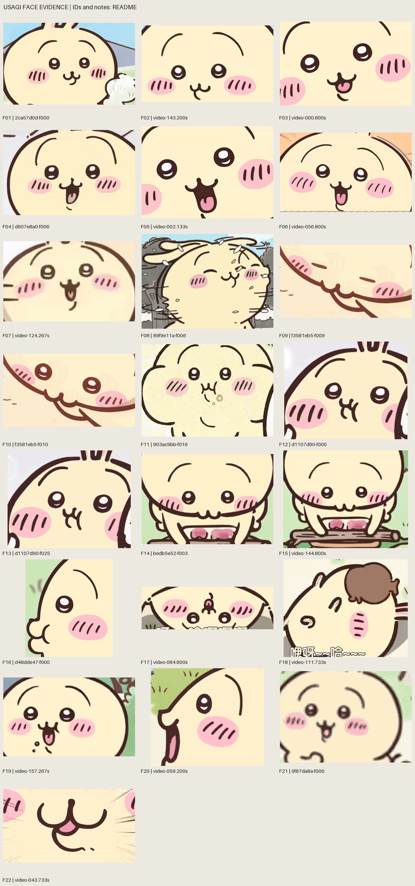
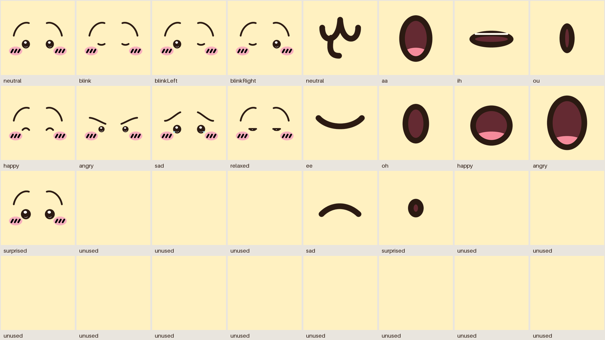

# 乌萨奇：表情、动作与叫声画面对照（018）

研究基线：2026-11-16，仓库 `262f284`。只整理参考，未改程序、模型、音频清单或图集。先看[五官总览](face/overview.png)、[现有图集原样副本](face/atlas_preview.png)，再按下面的来源与帧号回查。

## 阅读口径与覆盖范围

- **以下所有动作命名、情绪含义、运动幅度、节奏与因果解释均为“仅画面推断”**，不是作者设定。表中“圆眼、ω上沿、短横”等是可见形状；无法辨认的写“看不清”，未观察到的不能当作角色绝不会做。
- **没有独立听审音轨**。叫声文字、label、可用/null 状态沿用 `assets/sounds/usagi/manifest.json`，同时核对视频可见字幕；无字幕的 GIF 不补配口癖，其他角色的对白、配乐与拟音不改认成乌萨奇声音。声音词与口形的精确音素同步仍待主导听审。
- 23 个 GIF 共 **534 原帧**，全部展开后逐帧查看；按相邻帧 RGB 平均绝对差、分时段取变化峰值，保留首尾，选 **260 帧**，每张 8–12 帧。透明 GIF 合成到白底；帧号从 **f000（0 基）**算，时间为各帧 GIF duration 累加的**显示起点**，循环时长含最后一帧的停留。
- 完整解码视频 `Material/Usagi_Voice.mp4`：1280×720、30fps，5542 视频帧；容器/音频约184.807s，视频末尾约184.733s。全时域每8原帧取一帧，得到 **693 个检查样本（间隔0.267s）**，结合帧差候选、0.8s全片巡览和全部声音区间逐段查看。这里的“全量”是覆盖全部素材与时间段的抽帧检查，**不是声称实时播放或逐张人工看完5542个原帧**。
- 视频按镜头切换和动作变化整理 **55 段**；转场边界来自0.267s检查网格，约有一个采样间隔误差，**不作为精确剪辑点**。每段按时间分箱选帧差峰值，保留首尾；只保留能见乌萨奇（含背面/耳朵/被遮挡）的样本。短暂跨镜头但有乌萨奇时在表中注明。纯旁人/道具镜头见排除表。
- 叫声 **86 段全部覆盖**，其中 **20 段 file 非空、66 段 null**；每段恰4帧。通常取区间内检查样本首尾和两处中间点；不足4个检查样本的短段改取区间内部的4个原视频帧，**没有取到声音区间外凑数**。因此0.41s的 `ha_01` 也有4帧，而非拿邻段替代。
- 拼图宽1280px；单张脸裁切宽400px、保持纵横比、不重画、不锐化补线、不旋转“修正”姿势。原图很小的GIF放大后仍模糊。F16/F20为侧脸补充；F17倒立、F18遮挡侧躺、F22嘴部特写没有清楚完整正脸，作为**局部特例**保留，不能据此编出眼眉。

## 最值得主导先看的五条特点（仅画面推断）

1. **表情辨识点在“圆眼＋高弧眉＋ω上沿”，开嘴仍常保留这三者。** 叫得很响也不是通用怒眉椭圆嘴；眼内上白点、下白弧和粉腮短线常保留。看 [V02 0.533–2.667s](video/000.533-002.667s.png)、[V18 56.000–57.867s](video/056.000-057.867s.png)、[F03 浅开ω小舌](face/浅开ω小舌-video-000.800s.png)、[F06 大开ω长叫](face/大开ω长叫-video-056.800s.png)。
2. **短脚小步、并脚弹跳、边转边蹦是不同节奏。** 小跳可约0.26s一轮而闭ω不变；走入时短腿交替、手小摆，嘴可从开到闭；转圈有连续多个朝向。看 [81e28b67](gif/81e28b67.png)、[93a784a3](gif/93a784a3.png)、[c78ea0a6](gif/c78ea0a6.png)。不能用同一条上下正弦包办。
3. **小手很忙，常在胸前交错/搓动、卷在体侧或摊开，长叫未必举高手臂。** 胸前动作约0.1s级换帧，头脸可以停住；正面走跑常左右手交替。看 [0f87da8a](gif/0f87da8a.png)、[1c2eff26](gif/1c2eff26.png)、[V19 57.867–60.533s](video/057.867-060.533s.png)、[V55 180.533–184.733s](video/180.533-184.733s.png)。
4. **耳朵是动作的结果，甩水是特殊的大幅例外。** 普通走跳中耳随头倾；急转时向后倾弯（滞后机制为推断），甩水时能甩到近水平，身体边缘也出现横向拉扯/速度抹帧。看 [89f9e11a](gif/89f9e11a.png)、[dcb25159](gif/dcb25159.png)、[e92427f9](gif/e92427f9.png)。不能把单纯摇头当成独立耳动已完成。
5. **爆发后有停顿、定姿和局部小动，身体并非一直规则呼吸摇摆。** 大下沉再回画之后停着抖手，转侧后停住，吃饱能躺数秒；夸张时也可倒立、鼓颊，而非仅把整模型均匀缩放。看 [1c2eff26](gif/1c2eff26.png)、[a694b860](gif/a694b860.png)、[V24 76.533–82.133s](video/076.533-082.133s.png)、[V26 83.733–85.600s](video/083.733-085.600s.png)、[F11 鼓颊缩口](face/鼓颊缩口-903ac9bb-f016.png)。

## GIF／视频总表

以下两张表共同组成完整总表：每个GIF与每个保留视频片段各一行，含拼图路径、动作、五官、身体/耳、节奏/时长和声音依据。动作与节奏均按上述“仅画面推断”口径。

### 全部23个GIF

| 原始GIF | 拼图／帧数／循环时长 | 动作（推断） | 眼／嘴／眉／腮红 | 身体／耳朵／节奏（推断） | 典型叫声依据 |
| --- | --- | --- | --- | --- | --- |
| [0f87da8acad01bd192a02bd02d4fc0a307807187.gif](../../../Material/0f87da8acad01bd192a02bd02d4fc0a307807187.gif) | [拼图](gif/0f87da8a.png)<br>8→8帧；0.800s | 胸前交替搓手/摆臂 | 圆眼带双高光；小ω上沿加小开口/舌；弧眉、粉腮三四短线稳定。嘴在几帧有细微开合，不能说整张脸完全不变。 | 手在胸前短促交错，身体轻晃，耳直立仅随头动；约0.2–0.4s一组手部往复。 | GIF无声，不定叫声 |
| [160c479d727476546b1c0c003d15b3f5a6628d9b.gif](../../../Material/160c479d727476546b1c0c003d15b3f5a6628d9b.gif) | [拼图](gif/160c479d.png)<br>9→9帧；0.900s | 取食送嘴、咀嚼 | 圆眼弧眉不变；f2送嘴小开，f3–4缩口/食屑，f6收口。腮红随脸走，不是哭。 | 单手从桌旁到嘴边反复，头轻摆，耳随头倾，无大甩耳。 | GIF无声；仅见进食 |
| [1c2eff26d093dbdb22ce9a237fd153a91942011.gif](../../../Material/1c2eff26d093dbdb22ce9a237fd153a91942011.gif) | [拼图](gif/1c2eff26.png)<br>43→12帧；2.010s | 向下蹲出画再弹起，胸前抖手 | 圆眼、张口带舌基本保留；f9–13脸出画看不清；回画后同类开口。眉腮红随头倾。 | 前0.7s大幅下沉再起；之后手约0.1s一换，头侧倾停留，耳跟随头，不是每帧都跳。 | GIF无声 |
| [2ca57d0da1e611c5284873ecbb0fc8514a9949c6.gif](../../../Material/2ca57d0da1e611c5284873ecbb0fc8514a9949c6.gif) | [拼图](gif/2ca57d0d.png)<br>16→12帧；1.280s | 端叉看冒热气食物 | 圆眼、闭口ω及偏左下小尾钩；高弧眉、粉腮斜线基本不变。 | 头身几乎定住，耳平行竖立；主要变化是蒸汽，道具变化不能当成呼吸/表情变化。 | GIF无声 |
| [4dc8baf5cd2adcab35297a54cc77d1ea1942011.gif](../../../Material/4dc8baf5cd2adcab35297a54cc77d1ea1942011.gif) | [拼图](gif/4dc8baf5.png)<br>13→12帧；1.040s | 看泡泡、手在身前 | 圆眼、闭口小ω和短尾；弧眉粉腮稳定。白泡泡遮过脸，不能当汗滴/泪珠。 | 头轻微下移偏转，最后手落下；耳维持直立随头，泡泡独立漂动。 | GIF无声 |
| [669cf400137587810e16c75b2d69da9774bd2ce3.gif](../../../Material/669cf400137587810e16c75b2d69da9774bd2ce3.gif) | [拼图](gif/669cf400.png)<br>24→12帧；2.400s | 红光中凝视，镜头推近 | 圆眼高光、闭口ω短尾、弧眉粉腮；f13–15双影是叠化，不是双瞳或变脸。 | 几乎静止；约1.3–1.6s镜头推近/叠化。看不清身体、无甩耳证据。 | GIF无声 |
| [7d4e64a0e27d910c644628842f13004173d7cc2c.gif](../../../Material/7d4e64a0e27d910c644628842f13004173d7cc2c.gif) | [拼图](gif/7d4e64a0.png)<br>49→12帧；3.500s | 叉食、鼓嘴咀嚼，再仰头张嘴 | f0闭ω；f6食物遮嘴；f9–18鼓颊缩口；f19–24咀嚼ω变化；f26后张口带舌。圆眼弧眉保持；108px原图细节看不清。 | 前1.8s送食与咀嚼停顿；后仰头、抬手，耳向后倾；小图不可精量。 | GIF无声 |
| [7f1ef01d996e7adba46e30f233abd61f1942011.gif](../../../Material/7f1ef01d996e7adba46e30f233abd61f1942011.gif) | [拼图](gif/7f1ef01d.png)<br>21→12帧；1.680s | 坐着捧面包，张口反应 | f0–2咀嚼闭口/食屑，f3–20小到中开ω口带舌；圆眼、弧眉粉腮不变，未见怒眉。 | 身体坐稳、手抱食物，仅头及耳小幅上下弹动。 | GIF无声；画面近似视频157–159s，不据此声称同音轨 |
| [81e28b672ef6ae159bfb6969a079cca21942011.gif](../../../Material/81e28b672ef6ae159bfb6969a079cca21942011.gif) | [拼图](gif/81e28b67.png)<br>8→8帧；1.040s | 双脚并拢的小弹跳 | 圆眼、闭口ω带短尾始终同类；弧眉粉腮随头整体动。 | f0空中→f1落地→f2空中，约0.26s一跳；头身轮廓上下收展，短手贴侧，耳轻微滞后倾斜（推断）。 | GIF无声；跳跃不等于一定张嘴 |
| [89f9e11aca7a61f5db2ac315bb0aa3bb1942011.gif](../../../Material/89f9e11aca7a61f5db2ac315bb0aa3bb1942011.gif) | [拼图](gif/89f9e11a.png)<br>36→12帧；1.080s | 闭眼高速左右甩水 | 两眼从圆眼改为上弧闭眼，ω闭嘴保留；弧眉、腮红随脸甩；f2等为速度线抹帧，不当无五官表情。水珠不是哭。 | 耳大幅近水平向两侧甩，头身左右抖、轮廓横向拉扯，0.09–0.18s可见一次换边。 | GIF无声 |
| [903ac9bb2ae66096154d0ad3c806025bc1c29809.gif](../../../Material/903ac9bb2ae66096154d0ad3c806025bc1c29809.gif) | [拼图](gif/903ac9bb.png)<br>32→12帧；3.520s | 大口吞食后鼓颊咀嚼 | f0–3脸仰起部分遮挡；f4–13只见上仰缩嘴；f14后圆眼、闭口缩ω、鼓出的两颊与食屑。眉腮红在回正后可见。 | 吞咽后约1s仰头停顿，再低头；鼓颊轮廓明显扩大，耳从出画到倾回。 | GIF无声 |
| [93a784a3d5bd0aaeeed6dba21e9329991942011.gif](../../../Material/93a784a3d5bd0aaeeed6dba21e9329991942011.gif) | [拼图](gif/93a784a3.png)<br>21→12帧；2.730s | 从右往左小步跑/走入 | f0–8嘴小开带舌，f9以后收成闭ω；眼仍圆、眉弧、腮红不改。说明普通移动中也可收口，不只情绪时变。 | 短腿交替、全身轻弹和侧摇，手很小幅摆，耳跟头左右倾；约0.26–0.52s一步。 | GIF无声 |
| [9bc8323968da2c46c71b4cfbec304ddbba502f55.gif](../../../Material/9bc8323968da2c46c71b4cfbec304ddbba502f55.gif) | [拼图](gif/9bc83239.png)<br>56→12帧；2.330s | 连转、扭腰、歪头再转背 | 可见正脸时圆眼闭ω、弧眉粉腮；背面无脸不是闭眼。 | 短脚附近为轴，手侧伸，尾巴在背面显眼；0.8s内背→正，约1.3s又到背，耳随倾身甩弧。部分镜头只拍下半身。 | GIF无声 |
| [a694b860e187ac78192c5f0e502fad2a1942011.gif](../../../Material/a694b860e187ac78192c5f0e502fad2a1942011.gif) | [拼图](gif/a694b860.png)<br>8→8帧；1.040s | 鼓嘴后猛转侧面 | 前3帧圆眼、缩闭口/食屑，后侧面ω凸出；弧眉和腮红沿面部转向，非平贴相机。 | 约0.26–0.39s突然转到侧面，躯干前倾、尾巴露出，耳向后偏；之后侧姿停住。 | GIF无声 |
| [bedb5e52cf6a52ef9b1d11359a6c5c501942011.gif](../../../Material/bedb5e52cf6a52ef9b1d11359a6c5c501942011.gif) | [拼图](gif/bedb5e52.png)<br>13→12帧；1.040s | 俯身两手反复压面包/果酱 | 圆眼、弧眉粉腮仍在；闭口ω压在头部下缘，脸因俯视显得扁；下方粉色块是果实/果酱，不是张嘴和舌。 | 双手向下压、身体前倾，耳基本直；约0.16–0.32s一轮，末段道具整体抬起。 | GIF无声；相似视频144–147s配ura升调 |
| [c78ea0a638d419a6baa3e0e65da34bba497afc15.gif](../../../Material/c78ea0a638d419a6baa3e0e65da34bba497afc15.gif) | [拼图](gif/c78ea0a6.png)<br>30→12帧；3.000s | 边转圈边跳着跑远 | 正/侧可见圆眼、中开ω带舌、弧眉粉腮；背脸不可见；缩小来自跑远，不是瞳孔缩小。 | 左右侧→正→背连续切向、短腿蹦，手一高一低，耳随方向后倾；约0.6–1s一个朝向循环。 | GIF无声 |
| [d1107d90efca3b461825b456abbf5f4b1942011.gif](../../../Material/d1107d90efca3b461825b456abbf5f4b1942011.gif) | [拼图](gif/d1107d90.png)<br>33→12帧；2.340s | 坐桌边鼓嘴、反复咀嚼 | f0缩ω与鼓颊，f5略开，f9/20紧缩，f25回ω；眼圆弧眉粉腮大致稳定，不是悲伤。 | 身体基本不动，口颊在约0.3–0.5s间收放；耳随头轻摆，不单独摆耳。 | GIF无声 |
| [d48dde477eee3a58a5646ea9038dd51b1942011.gif](../../../Material/d48dde477eee3a58a5646ea9038dd51b1942011.gif) | [拼图](gif/d48dde47.png)<br>11→11帧；0.880s | 侧脸抬手示意、手腕翻动 | 只见一只圆眼和一边弧眉腮红，嘴突出成双小弧/鼓唇；五官不随手势开合。 | 手在胸前上下翻，约0.32–0.4s一轮；头身几乎静止，耳出画看不清。 | GIF无声；与视频159.7–161.6s近似 |
| [d607e8a01175e0cd443fc8df50dbddc01942011.gif](../../../Material/d607e8a01175e0cd443fc8df50dbddc01942011.gif) | [拼图](gif/d607e8a0.png)<br>35→12帧；1.720s | 抱臂/交手后张嘴，头小幅歪 | f0–4闭ω与短尾，f5后改为ω上沿+竖向开口+舌；眼圆、弧眉粉腮无愤怒变形。 | 手臂交在胸前，头缓慢摆到一侧，耳跟随头；张嘴后持续约1.2s，不是频繁眨眼。 | GIF无声 |
| [dcb251595f98255a81109cfc47bc01ab1942011.gif](../../../Material/dcb251595f98255a81109cfc47bc01ab1942011.gif) | [拼图](gif/dcb25159.png)<br>16→12帧；1.130s | 原地快速转圈、短脚点地 | 正脸f2等为圆眼、张口ω带舌、弧眉粉腮；侧脸只有单眼；背面无脸。 | 约0.35s转一圈，共约3圈；手侧摊、脚接近并拢、耳明显落后倾弯（推断），身体不是刚性柱体。 | GIF无声；相似视频pururu_01 |
| [e92427f9c72831c0d06532dc194b4d471942011.gif](../../../Material/e92427f9c72831c0d06532dc194b4d471942011.gif) | [拼图](gif/e92427f9.png)<br>23→12帧；1.620s | 侧背来回扭臀、尾巴晃 | 只在侧面看见单圆眼、凸出闭ω与粉腮；眉局部出画；背面无脸不可补画。 | 约0.57s背→侧循环；手卷在体侧，尾巴沿背部横扫，耳随转向倾，不是单独头摇。 | GIF无声；近似视频other_70 |
| [f3581eb5b5da21e320a31327642513681942011.gif](../../../Material/f3581eb5b5da21e320a31327642513681942011.gif) | [拼图](gif/f3581eb5.png)<br>17→12帧；1.360s | 弯腰贴近地上融化物，眨眼 | 圆眼闭ω；f9/f11变成短横闭眼，f10/f12回圆眼；眉和粉腮不变。嘴是贴近脸轮廓的侧扁ω，不是张口。 | 脸大幅侧斜下探，手/身体出画；头静止间插入约0.08s闭眼，不能把镜头裁切当身体压扁。 | GIF无声 |
| [fa5472df8f03bad516b4d1eb7330ae0b1942011.gif](../../../Material/fa5472df8f03bad516b4d1eb7330ae0b1942011.gif) | [拼图](gif/fa5472df.png)<br>12→12帧；1.620s | 正面小跑/摆臂，尾段停稳 | f0–9圆眼、中小开ω带舌，f10–11闭ω；眉腮红随头动，耳端在不同步幅间倾斜。 | 左右手交替摆到肩下，腿短而快，轻微上下弹；单步约0.2–0.3s，末段收势。 | GIF无声；155px原图细节有限 |

### 视频全部55个保留片段

每行时长是该段画面长度，不等于一次动作的周期。腮红默认粉色椭圆＋三四短线，除遮挡、透视或特别说明外未见独立改形。

| 视频片段→拼图 | 动作（推断）／片段长度 | 眼／嘴／眉／腮红 | 身体／耳朵／节奏（推断） | 叫声／字幕依据 |
| --- | --- | --- | --- | --- |
| [V01 0.000–0.533s](video/000.000-000.533s.png) | 开场正脸推近；0.533s | 圆眼、闭ω→小开ω，弧眉粉腮稳定 | 双手在脸下；镜头推近，不能当眼睛变大 | other_01，无字幕待听审 |
| [V02 0.533–2.667s](video/000.533-002.667s.png) | 张口特写；2.133s | 圆眼；ω上沿保留，开口由浅到竖长、舌可见，下方尾钩/下唇线分离；眉粉腮不变 | 头小幅歪，手在画角；以嘴变化为主 | other_01，无字幕待听审 |
| [V03 2.667–4.533s](video/002.667-004.533s.png) | 对吉伊搓手；1.867s | 圆眼、小开ω，弧眉粉腮稳定 | 坐/蹲姿，双手胸前快速交错，耳小幅跟头 | other_02，无字幕待听审 |
| [V04 4.533–6.400s](video/004.533-006.400s.png) | 侧脸摆手；1.867s | 单圆眼；侧面凸ω开口；另一眼看不到 | 短手胸前绕动，头身略晃，耳部分出画 | other_02–03，混音待听审 |
| [V05 6.400–9.600s](video/006.400-009.600s.png) | 正面搓手收尾；3.200s | 圆眼；小开ω与闭ω交替，眉粉腮稳定 | 站姿手快速内收外摆；耳竖立，尾部短抖线 | other_03–04，混音待听审 |
| [V06 9.600–14.133s](video/009.600-014.133s.png) | 骑鱼飞行正面；4.533s | 小圆眼、小开嘴；距离远，嘴细节看不清 | 双手张开、耳后倾，身体随鱼上下；不等同自主飞行 | other_05–06，多角色/拟音混合 |
| [V07 14.133–18.933s](video/014.133-018.933s.png) | 骑鱼转向远去；4.800s | 侧脸单眼，远景五官看不清 | 耳被气流/转向压后（推断），身体随鱼转侧后，逐渐远离 | other_06–09，不能归独立叫声 |
| [V08 18.933–24.800s](video/018.933-024.800s.png) | 目光束旋转；5.867s | 发光遮住眼形，看不清是否瞪眼；局部粉腮可见，口形不清 | 身体绕轴转、双手外摊，耳随转；约1s量级一圈，亮闪不能作形变 | other_09–11，其他角色祈愿/光束拟音 |
| [V09 28.800–31.733s](video/028.800-031.733s.png) | 烟旁小弹跳；2.933s | 圆眼闭ω、弧眉粉腮；不是每跳闭眼 | 并脚快速离地落地，手贴侧，耳短促摆，约0.3s一跳 | other_13–14，跳跃拟音，无独立叫声证据 |
| [V10 31.733–36.000s](video/031.733-036.000s.png) | 林间交谈侧背；4.267s | 单圆眼、凸闭ω，眉局部可见 | 身子停住，耳自然后倾，尾巴背部；其他角色讲话 | other_15–16，小八对白 |
| [V11 36.000–37.867s](video/036.000-037.867s.png) | 抱臂准备举证件；1.867s | 圆眼闭ω，高弧眉粉腮 | 前臂交胸再放下，头基本定住，耳直立 | other_17，未确认口癖 |
| [V12 39.467–43.467s](video/039.467-043.467s.png) | 侧背举证件连声；4.000s | 侧面圆眼和凸口，ω下沿/尾钩短震，远景口腔看不清；眉腮红不明显变形 | 单手举卡固定，另一手小幅摆，耳随头；约4s保持自得姿 | other_18他人对白；other_19为ウルルル，不能标pururu |
| [V13 43.467–44.533s](video/043.467-044.533s.png) | 嘴部超近景；1.067s | ω上沿+下垂偏侧尾钩；小粉舌/小开口；眼眉出画 | 嘴角短线表示震动（推断），只够参考嘴，不可补眼 | other_20长连叫开头 |
| [V14 44.533–46.667s](video/044.533-046.667s.png) | 抓藤摆荡并推近；2.133s | 圆眼、竖开ω舌口、高弧眉粉腮；镜头放大并非瞪眼 | 手握藤、身体悬起，另一手靠近，耳随头倾 | other_20长连叫 |
| [V15 46.667–49.333s](video/046.667-049.333s.png) | 从藤落地，背面转身；2.667s | 背面看不清五官；转侧时局部脸仍不足以判口形 | 下坠、并脚着地、轮廓低一点再恢复，转侧；耳先短后直（透视/倾斜推断） | other_21–22，拟音/尾声待听审 |
| [V16 49.333–52.800s](video/049.333-052.800s.png) | 正面踏步念四音节；3.467s | 圆眼；小开/中开ω舌口，眉粉腮基本不变 | 脚左右交替，手反向小摆，身子侧摇、耳随头；约0.5s一步 | other_23 乌・呀・咿・哈 |
| [V17 52.800–56.000s](video/052.800-056.000s.png) | 靠近小桃；3.200s | 圆眼小开ω→闭ω，弧眉粉腮稳定 | 边短步边摆手，停到小桃身旁，耳由后倾回直 | other_24连声、other_25他人对白 |
| [V18 56.000–57.867s](video/056.000-057.867s.png) | 正面大声长叫；1.867s | 圆眼保持；ω双弧上沿+大竖开口+舌，弧眉未改怒眉，粉腮仍在 | 头胸轻震、耳直立，开口持续约2s | other_26连续长叫 |
| [V19 57.867–60.533s](video/057.867-060.533s.png) | 侧脸朝小桃长叫；2.667s | 单圆眼；嘴突出并竖长张开，眉弧、粉腮不变；小桃才是双影震动脸 | 身体前倾定住、耳偏后，不是两臂举过头 | other_26续，切勿抄小桃震动眼 |
| [V20 62.933–66.933s](video/062.933-066.933s.png) | 背对走远；4.000s | 背面看不清眼口眉；只见尾巴 | 短步走远，耳并列、尾巴横抖、身侧轻摇 | yaha_02/other_28在背面，other_29小桃驱赶 |
| [V21 70.400–71.733s](video/070.400-071.733s.png) | 沿路冲来；1.333s | 由远到近圆眼、小开ω舌口，弧眉粉腮；不是放大眼珠 | 短腿交替+跃起冲刺，手侧摆，耳起伏；约1.6s由远到近 | yaha_03 咿呀～哈 |
| [V22 71.733–73.600s](video/071.733-073.600s.png) | 铲挖巨型食物；1.867s | 侧眼、嘴被食物/道具遮挡，看不清开合 | 手持勺向前戳挖，身体前倾、尾巴朝后、耳跟头 | yaha_03尾声/other_32，动作拟音 |
| [V23 73.600–76.533s](video/073.600-076.533s.png) | 钻食物后鼓嘴；2.933s | 先背/遮脸；回正后圆眼、鼓颊、缩闭ω，粉腮仍在 | 头前扎进食物再抬起，双手靠胸，耳从后倾回直 | other_32–33，咀嚼拟音待听审 |
| [V24 76.533–82.133s](video/076.533-082.133s.png) | 吃饱躺倒；5.600s | 只见仰起/侧倒局部，眼口多数看不清；不能认旁边闭眼为乌萨奇 | 身体向后滚倒、短手收起、耳随倒地铺侧，停躺数秒 | other_34–36为小八对白/片尾拟音 |
| [V25 82.133–83.733s](video/082.133-083.733s.png) | 拍照前站定；1.600s | 圆眼闭ω，高弧眉粉腮，不因他人说话开口 | 并脚站定，双手垂侧，耳平行竖立 | other_37是小八说要拍了哦 |
| [V26 83.733–85.600s](video/083.733-085.600s.png) | 翻身倒立摆拍；1.867s | 倒置圆眼、张口ω小舌，粉腮随整脸倒置；眉被透视压近/看不清 | 翻到头朝下尾朝上，两手向外撑，耳摊在地；约1.8s保持倒立 | yaha_04 长呀哈；尾部切到摄影者 |
| [V27 94.933–96.533s](video/094.933-096.533s.png) | 靠近新朋友；1.600s | 边缘侧脸：单圆眼、凸闭ω，弧眉粉腮 | 贴近吉伊手中小动物，头前探、耳微后倾 | other_42为他人对白 |
| [V28 96.533–98.133s](video/096.533-098.133s.png) | 小动物贴脸；1.600s | 小动物遮眼嘴，看不清；仅右侧粉腮/额头轮廓 | 头向前贴，短手抬起接近动物，耳仍直 | other_43，无明确独立叫声 |
| [V29 98.133–101.600s](video/098.133-101.600s.png) | 带小动物左右摆；3.467s | 圆眼、闭ω大致保持，低头后单眼局部；眉粉腮跟头 | 大幅歪头前俯，手与动物一起向两侧摆，耳由竖到斜 | other_44，无叫声字幕 |
| [V30 101.600–103.733s](video/101.600-103.733s.png) | 带小动物背面走远；2.133s | 背面，看不清五官 | 短腿交替、尾巴露出，耳并列，动物跟着移动 | other_45，无独立叫声证据 |
| [V31 103.733–106.400s](video/103.733-106.400s.png) | 和小动物一起蹦跑；2.667s | 圆眼、小开ω舌口、弧眉粉腮 | 交替抬脚兼离地小跳，手侧摆，耳一前一后倾；约0.3–0.5s一步 | other_46为旁人对白，不当乌萨奇发声 |
| [V32 110.133–112.800s](video/110.133-112.800s.png) | 地上翻躺连叫；2.667s | 脸大部分被小动物遮住；可见嘴从短弧到小椭圆/卷曲，眼眉看不清；粉腮随身体转 | 身体侧躺滚转、耳沿地甩，手脚翻动；与正立开心脸不同 | yaha_05（null）长呀哈 |
| [V33 112.800–114.933s](video/112.800-114.933s.png) | 旁人跳入、躺姿收尾；2.133s | 乌萨奇脸仍多遮挡/出画，不能抄旁人闭眼笑 | 继续小幅滚/蹭，耳横放；镜头上方是吉伊和小八 | yaha_05续，混其他角色/动作声 |
| [V34 114.933–117.333s](video/114.933-117.333s.png) | 家门口站走；2.400s | 圆眼闭ω，高弧眉粉腮 | 小幅交替踏步后站定，耳并列，手垂侧 | other_48是他人疑问 |
| [V35 117.333–119.200s](video/117.333-119.200s.png) | 挥白色道具；1.867s | 圆眼；闭ω→浅开ω→闭ω；眉粉腮保持 | 一手举到面侧又放下，身体略歪，耳随头；约1.9s | yaha_06 呀呀呀哈 |
| [V36 119.200–121.867s](video/119.200-121.867s.png) | 俯身看融化物；2.667s | 圆眼、闭ω，短暂横线闭眼见GIF f358补证；眉粉腮稳定 | 大幅歪头下探，道具在地上；耳局部出画 | other_49为旁人对白 |
| [V37 121.867–123.733s](video/121.867-123.733s.png) | 背对看地上物；1.867s | 背面无五官可判 | 短脚定住、尾巴居中、耳直；起转前手侧伸 | other_49尾段/起转动作 |
| [V38 123.733–125.600s](video/123.733-125.600s.png) | 原地高速转身；1.867s | 正面圆眼、中开ω舌口；侧单眼；背面无脸；弧眉粉腮保留 | 双手摊侧、近并脚为轴；约0.35–0.6s一圈，耳滞后倾弯（推断） | pururu_01 噗噜噜 |
| [V39 125.600–126.667s](video/125.600-126.667s.png) | 门内视角只露耳；1.067s | 眼口眉不可见；不要拿吉伊/小八脸配乌拉 | 耳在画面底部出现，身体大半出画 | ura_01 乌拉 |
| [V40 126.667–128.800s](video/126.667-128.800s.png) | 背一捆长物敲门；2.133s | 道具挡脸/背面，眼口眉看不清 | 背负大捆物、脚快速踢/踏，耳从上缘伸出；约2.1s | other_50为小八对白，敲门拟音 |
| [V41 128.800–133.600s](video/128.800-133.600s.png) | 前景侧背连声扭头；4.800s | 单圆眼、凸闭/浅开ω交替；眉一侧弧形，粉腮跟转；口腔细节小 | 侧→背→侧反复、耳摆动，短手卷在旁；后半停住听对白 | other_51混合口癖；other_52他人对白 |
| [V42 136.533–140.800s](video/136.533-140.800s.png) | 树丛摘果；4.267s | 圆眼、闭ω，高弧眉粉腮；前段嘴细节小 | 小步侧移，头微倾，单手伸进树丛再举起，耳随倾头 | ura_03尾段/other_53–54；画外口癖不能逐元音对嘴 |
| [V43 140.800–144.000s](video/140.800-144.000s.png) | 揉捏果子近景；3.200s | 圆眼、闭ω尾钩，弧眉粉腮全稳定 | 两手身前挤果子、身体略歪回正，耳直立；面部不跟手变 | other_55，动作拟音 |
| [V44 144.000–147.200s](video/144.000-147.200s.png) | 俯身压果酱面包；3.200s | 圆眼弧眉保留；闭ω贴近头部下缘，俯视下眼嘴距离变短；下方粉色是果实/果酱，不是口腔，腮红随脸移动 | 两手大幅向下压，身体反复俯起，耳基本直；约0.2–0.3s一压 | ura_04→other_56升调连声；other_57动作声 |
| [V45 147.200–149.333s](video/147.200-149.333s.png) | 看热石上面包；2.133s | 侧脸单圆眼、凸ω，眉粉腮稳定 | 站看、头微下探，耳稍倾；蒸汽来自食物/热石 | other_57–58，无独立叫声证据 |
| [V46 152.000–153.333s](video/152.000-153.333s.png) | 张嘴咬面包；1.333s | 圆眼；中开ω舌口→面包挡口；弧眉粉腮稳定 | 两手举食物到嘴前，耳倾一下再回直 | other_59进食拟音 |
| [V47 153.333–156.800s](video/153.333-156.800s.png) | 鼓颊咀嚼；3.467s | 圆眼、缩闭ω与鼓颊/食屑；眉粉腮不变；背景流口水脸是小桃 | 手持面包，头微点、耳直；约0.3–0.5s口颊循环 | other_60–62，じゅるり属小桃 |
| [V48 156.800–159.733s](video/156.800-159.733s.png) | 坐着哈问句与升调啊；2.933s | 圆眼、弧眉；闭缩口→小/中开ω舌口；未见怒眉/瞪大眼，粉腮稳定 | 坐稳捧食物，短手不离面包，耳小幅弹 | ha_01→other_63；other_64是小桃对白 |
| [V49 159.733–161.600s](video/159.733-161.600s.png) | 侧脸翻手示意；1.867s | 单圆眼凸闭ω，弧眉粉腮不改，不随手张口 | 手掌在胸前反复翻抬；耳出画 | other_64尾段/other_65，短音待听审 |
| [V50 163.200–165.867s](video/163.200-165.867s.png) | 侧前景听对方谈条件；2.667s | 单圆眼凸闭ω、弧眉粉腮保持 | 手在胸前停住，头轻歪；耳斜后 | other_67他人对白，不能当乌萨奇生气 |
| [V51 169.333–171.200s](video/169.333-171.200s.png) | 吃完站起鼓嘴；1.867s | 圆眼、闭缩ω、少量食屑，弧眉粉腮稳定 | 两手垂侧站起，身体小幅左右晃，耳由直略倾 | other_69，咀嚼/转身拟音 |
| [V52 171.200–172.267s](video/171.200-172.267s.png) | 近景转侧；1.067s | 圆眼闭缩ω，转侧后只见单眼，眉粉腮跟随 | 先歪头再突然转侧、耳后甩，尾巴进入视野 | other_69续 |
| [V53 172.267–178.133s](video/172.267-178.133s.png) | 侧背扭臀模仿；5.867s | 侧面单圆眼/凸闭ω，背面看不见；无怒眉证据 | 短脚定点，左右侧背快速扭换，手卷在腰侧，尾巴大幅扫、耳随身甩；约0.5–0.7s一轮 | other_70混合口癖，other_71是小桃对白/重叠声，other_72片尾 |
| [V54 178.133–180.533s](video/178.133-180.533s.png) | 正面听邀请；2.400s | 圆眼闭ω，高弧眉粉腮不变 | 手侧放、短脚站定，耳平行；邀请时不张嘴 | other_73是小八对白，其中噗不是乌萨奇pururu |
| [V55 180.533–184.733s](video/180.533-184.733s.png) | 正面连叫转圈再张手；4.200s | 圆眼；闭ω→中开ω舌口；背面无脸；眉粉腮不改 | 先胸前抖手，再转背回正、双手摊开，耳跟转向倾；末约2s同一张口脸停留 | other_74 乌・拉・呀・哈・呀哈・乌・拉 |

### 未放入video/的纯旁人或道具区间

排除只影响video动作表；这些时间对应的manifest记录仍在voice/，没有删掉null或画外声音。下列为约数；开头/结尾转场中能见乌萨奇的样本由相邻保留段覆盖，极小远处人影可优先查声音拼图。

| 约秒数 | 排除原因 | 仍可回查的声音拼图 |
| --- | --- | --- |
| 24.800–28.800 | 小八持棍、喷烟；28.533s尚无乌萨奇，28.800s起跳入 | [other_12](voice/other_12.png)、[other_13](voice/other_13.png) |
| 37.867–39.467 | 证件特写，仅静态小头像，不能提供发声表情 | [yaha_01](voice/yaha_01.png) |
| 60.533–62.933 | 小桃震动特写，不是乌萨奇 | [other_27](voice/other_27.png)、[yaha_02](voice/yaha_02.png) |
| 66.933–70.400 | 吉伊/小八看巨大食物；70.200s声音采样已能见极远乌萨奇，脸看不清，video从70.400s保留 | [other_30](voice/other_30.png)、[other_31](voice/other_31.png) |
| 85.600–94.933 | 小八相机、片头、对白及小动物；94.933s乌萨奇从右边缘出现 | [other_38](voice/other_38.png)、[other_39](voice/other_39.png)、[other_40](voice/other_40.png)、[other_41](voice/other_41.png)、[other_42](voice/other_42.png) |
| 106.400–110.133 | 吉伊和小八评论，不把他们的闭眼笑当乌萨奇 | [other_46](voice/other_46.png)、[other_47](voice/other_47.png) |
| 133.600–136.533 | 面包特写，乌萨奇在画外 | [ura_02](voice/ura_02.png)、[ura_03](voice/ura_03.png) |
| 149.333–152.000 | 果酱面包说明画面 | 相邻[other_58](voice/other_58.png)／[other_59](voice/other_59.png) |
| 161.600–163.200 | 食物想象插画 | [other_66](voice/other_66.png) |
| 165.867–169.333 | 小桃侧背说不要，不是乌萨奇拒绝表情 | [other_68](voice/other_68.png) |
| 184.733–184.807 | 容器尾部音频余量，没有新视频帧 | [other_74](voice/other_74.png) |

## 五官形态与特写目录（重点）



总览里的F号对应下表；这是一组“可见形态＋姿态对照”，不是22种互斥情绪。相同形态最多选两处互证：常态F01/F02、竖开F04/F05、俯压F14/F15；其余为单例或特例。正常正脸优先于侧脸、倒立和遮挡样本。

| 特写路径 | 来源原帧／时间 | 眼嘴眉形状／伴随动作与叫声 |
| --- | --- | --- |
| [F01 常态圆眼闭ω](face/常态圆眼闭ω-2ca57d0d-f000.png) | 2ca57d0d f0／0.000s | 圆眼内上白点+下白弧；高弧眉；ω双弧和偏左下短尾；粉腮三四短斜线。无声的端食物停顿。 |
| [F02 常态圆眼闭ω](face/常态圆眼闭ω-video-143.200s.png) | video f4296／143.200s | other_55捏果子：手在动而嘴闭合；和GIF共同校准比例。 |
| [F03 浅开ω小舌](face/浅开ω小舌-video-000.800s.png) | video f24／0.800s | other_01：上沿仍是ω，开口浅，舌粉色，嘴下有独立弧线；眼眉不改。 |
| [F04 竖开ω舌口](face/竖开ω舌口-d607e8a0-f006.png) | d607e8a0 f6／0.240s | f6/0.24s抱臂张口：眼圆、眉弧；开口从ω中部向下延长，舌在底端。 |
| [F05 竖开ω舌口](face/竖开ω舌口-video-002.133s.png) | video f64／2.133s | other_01：与0.8s同镜头比较口腔加深，不能把上沿抹成椭圆。 |
| [F06 大开ω长叫](face/大开ω长叫-video-056.800s.png) | video f1704／56.800s | other_26：长叫保持圆眼弧眉，ω上沿+长开口/舌，非怒脸。 |
| [F07 旋转圆眼开ω](face/旋转圆眼开ω-video-124.267s.png) | video f3728／124.267s | pururu_01正面：普通圆眼、中开ω，不是小O撅嘴。 |
| [F08 闭眼上弧甩水](face/闭眼上弧甩水-89f9e11a-f006.png) | 89f9e11a f6／0.180s | f6/0.18s：双眼上弧闭合、ω闭口不改；水滴和速度线属于甩水。 |
| [F09 短横闭眼](face/短横闭眼-f3581eb5-f009.png) | f3581eb5 f9／0.720s | f9/0.72s：短横闭眼、斜脸ω闭嘴；眉局部出画；不是笑弧眼。 |
| [F10 短横闭眼对照圆眼](face/短横闭眼对照圆眼-f3581eb5-f010.png) | f3581eb5 f10／0.800s | f10/0.8s：与前一帧同姿重新圆眼；用于区分眨眼与头移动。 |
| [F11 鼓颊缩口](face/鼓颊缩口-903ac9bb-f016.png) | 903ac9bb f16／1.760s | f16/1.76s：鼓出双颊、小缩ω、食屑；圆眼弧眉与粉腮保留。 |
| [F12 鼓颊紧缩ω](face/鼓颊紧缩ω-d1107d90-f000.png) | d1107d90 f0／0.000s | f0：嘴中部向内挤，鼓颊；不是现有sad倒弧嘴。右侧别的角色有遮挡。 |
| [F13 咀嚼回ω](face/咀嚼回ω-d1107d90-f025.png) | d1107d90 f25／1.780s | f25/1.78s：同机位收放后回ω，眼眉不随咀嚼改形。 |
| [F14 俯压闭ω姿态](face/俯压闭ω姿态-bedb5e52-f003.png) | bedb5e52 f3／0.240s | f3/0.24s：闭ω在头下缘，眼仍圆眉仍弧；下方双粉块是果实/果酱，不能抄成大开口。 |
| [F15 俯压闭ω姿态](face/俯压闭ω姿态-video-144.800s.png) | video f4344／144.800s | ura_04：俯视闭ω，眼嘴因姿态靠近；下方粉块是压果实，不据此画宽口。 |
| [F16 侧脸凸ω闭口](face/侧脸凸ω闭口-d48dde47-f000.png) | d48dde47 f0／0.000s | 只见单圆眼、弧眉和一侧腮红，ω凸在脸轮廓外；侧脸补充，非完整正脸。 |
| [F17 倒立张ω特例](face/倒立张ω特例-video-084.800s.png) | video f2544／84.800s | yaha_04倒立原方向：圆眼、小开ω，眉因姿态看不清；不是新增眼形。 |
| [F18 侧躺小椭圆口特例](face/侧躺小椭圆口特例-video-111.733s.png) | video f3352／111.733s | yaha_05：局部小椭圆/卷曲嘴，眼眉被动物遮挡；没有清楚正脸，不应补画。 |
| [F19 哈圆眼开ω](face/哈圆眼开ω-video-157.267s.png) | video f4718／157.267s | ha_01：捧食物的圆眼、弧眉、小开ω；没有明确怒眉/大瞪眼。 |
| [F20 侧脸竖长开ω](face/侧脸竖长开ω-video-059.200s.png) | video f1776／59.200s | other_26侧向长叫：单圆眼，凸ω上沿、竖开口/舌，眉弧粉腮；侧脸补充。 |
| [F21 小开ω搓手](face/小开ω搓手-0f87da8a-f000.png) | 0f87da8a f0／0.000s | f0/0s：胸前搓手时的ω下小开口与小舌，双圆眼弧眉不改；原图196px，不能精确量嘴的横向变形。 |
| [F22 连声浅缝ω特例](face/连声浅缝ω特例-video-043.733s.png) | video f1312／43.733s | other_20开头：ω双弧下浅粉三角/舌，偏侧尾钩有短震线。源镜头仅拍嘴，眼眉完全出画，没有可用正脸，保留局部特例。 |

### 按五官部件反查

| 部件／形态 | 片段与帧号 | 动作／叫声联系与证据边界 |
| --- | --- | --- |
| 眼：圆点/近圆椭圆，实色瞳内双白高光 | [F01 常态圆眼闭ω](face/常态圆眼闭ω-2ca57d0d-f000.png)、[F02 常态圆眼闭ω](face/常态圆眼闭ω-video-143.200s.png)；[V02 0.533–2.667s](video/000.533-002.667s.png) f24→f64；[V48 156.800–159.733s](video/156.800-159.733s.png) | 最常见。端食物、走跳、摇手、喊叫都可保留，不能拿镜头放大当瞪大眼。 |
| 眼：上弧闭眼 | [F08 闭眼上弧甩水](face/闭眼上弧甩水-89f9e11a-f006.png)，[89f9e11a](gif/89f9e11a.png) f6/0.180s、f16/0.480s | 闭眼甩水、耳横甩；GIF无声。支持闭眼笑弧形本身，不证明每次happy都应使用。 |
| 眼：短横闭眼→圆眼 | [F09 短横闭眼](face/短横闭眼-f3581eb5-f009.png)／[F10 短横闭眼对照圆眼](face/短横闭眼对照圆眼-f3581eb5-f010.png)；[f3581eb5](gif/f3581eb5.png) f9/0.720s→f10/0.800s、f11/0.880s再闭 | 观察融化物时短暂眨眼；闭眼约0.08s，和ω嘴不联动。不是情绪变脸才会闭眼。 |
| 眼：半睁/眯、瞪大、哭、流泪 | 本次未找到清楚乌萨奇正脸可证的独立形态；[V08 18.933–24.800s](video/018.933-024.800s.png)眼被光遮；[other_27](voice/other_27.png)／[other_68](voice/other_68.png)不是乌萨奇 | 不能把光束白眼、小桃震动/含泪脸、旁人半睁眼移植成乌萨奇证据。不是断言乌萨奇永不哭。 |
| 嘴：闭ω＋偏左下尾钩 | [F01 常态圆眼闭ω](face/常态圆眼闭ω-2ca57d0d-f000.png)／[F02 常态圆眼闭ω](face/常态圆眼闭ω-video-143.200s.png)；[2ca57d0d](gif/2ca57d0d.png) f0；[V43 140.800–144.000s](video/140.800-144.000s.png) f4296/143.200s | 静止、捏果、普通走跳可保持；尾钩是参考的标志，开口时可能变成分离下唇线。 |
| 嘴：ω下浅开口、小舌 | [F03 浅开ω小舌](face/浅开ω小舌-video-000.800s.png) video f24/0.800s；[F21 小开ω搓手](face/小开ω搓手-0f87da8a-f000.png) GIF f0；[F22 连声浅缝ω特例](face/连声浅缝ω特例-video-043.733s.png) video f1312/43.733s | other_01无字幕待听审；搓手GIF无声；other_20长连叫起始为浅粉三角/舌，眼出画，不能当标准O。 |
| 嘴：ω上沿＋向下竖开＋舌 | [F04 竖开ω舌口](face/竖开ω舌口-d607e8a0-f006.png) f6/0.240s；[F05 竖开ω舌口](face/竖开ω舌口-video-002.133s.png) video f64/2.133s；[F06 大开ω长叫](face/大开ω长叫-video-056.800s.png) f1704/56.800s；[F07 旋转圆眼开ω](face/旋转圆眼开ω-video-124.267s.png) f3728/124.267s | 抱臂张口、长叫、pururu旋转均可见；上沿不是椭圆，舌在下部，嘴下还可见短弧/尾线。 |
| 嘴：哈问句的小/中开ω | [F19 哈圆眼开ω](face/哈圆眼开ω-video-157.267s.png) f4718/157.267s；[ha_01](voice/ha_01.png) | 与圆眼弧眉一起出现，坐着拿面包；不支持预设成“怒眉＋小O”。仅一个ha样本。 |
| 嘴：侧面凸闭ω／竖长开ω | [F16 侧脸凸ω闭口](face/侧脸凸ω闭口-d48dde47-f000.png) GIF f0；[F20 侧脸竖长开ω](face/侧脸竖长开ω-video-059.200s.png) video f1776/59.200s | 翻手示意时闭口不动；other_26长叫侧面则竖长开口。侧脸只见单眼，不能当正脸眼距变化。 |
| 嘴：咀嚼紧缩/不对称ω、鼓颊 | [F11 鼓颊缩口](face/鼓颊缩口-903ac9bb-f016.png) f16/1.760s；[F12 鼓颊紧缩ω](face/鼓颊紧缩ω-d1107d90-f000.png) f0→[F13 咀嚼回ω](face/咀嚼回ω-d1107d90-f025.png) f25/1.780s；[V47 153.333–156.800s](video/153.333-156.800s.png) | 进食时口/颊会收放，圆眼弧眉多保留；周围小点为食屑/食物痕迹（推断），不是眼泪。 |
| 嘴：小椭圆/卷曲局部 | [F18 侧躺小椭圆口特例](face/侧躺小椭圆口特例-video-111.733s.png) f3352/111.733s；[yaha_05](voice/yaha_05.png) | 翻躺连叫，动物遮眼眉；只能证局部嘴，无法为此提供清楚完整正脸。 |
| 俯视与倒立的姿态变化 | [F14 俯压闭ω姿态](face/俯压闭ω姿态-bedb5e52-f003.png)／[F15 俯压闭ω姿态](face/俯压闭ω姿态-video-144.800s.png)；[F17 倒立张ω特例](face/倒立张ω特例-video-084.800s.png) | 俯压时闭ω在头下缘，脸扁是投影；下方粉色是果实/果酱，不是大开嘴/舌。倒立小开ω可见，脸整体旋转，不是五官换位。 |
| 眉：成对高弧、转侧剩单弧 | [F01 常态圆眼闭ω](face/常态圆眼闭ω-2ca57d0d-f000.png)／[F02 常态圆眼闭ω](face/常态圆眼闭ω-video-143.200s.png)／[F06 大开ω长叫](face/大开ω长叫-video-056.800s.png)／[F16 侧脸凸ω闭口](face/侧脸凸ω闭口-d48dde47-f000.png) | 常态、叫声、惊问都可保留。怒眉/八字悲眉没有清楚本角色证据；俯视时弧眉变浅需先扣除透视。 |
| 腮红：粉椭圆＋3或4条深色短线 | [F01 常态圆眼闭ω](face/常态圆眼闭ω-2ca57d0d-f000.png)／[F02 常态圆眼闭ω](face/常态圆眼闭ω-video-143.200s.png)／[F06 大开ω长叫](face/大开ω长叫-video-056.800s.png)；[4dc8baf5](gif/4dc8baf5.png) | 随面部转向/倾斜，不见独立情绪开关。斜线数、粗细随画风镜头变化，不可强制只画3条。 |
| 附加：水滴/速度线/食屑，未证哭泪汗滴 | [89f9e11a](gif/89f9e11a.png) f0–35；[4dc8baf5](gif/4dc8baf5.png) f0–12；[F11 鼓颊缩口](face/鼓颊缩口-903ac9bb-f016.png) | 甩水周围水滴、泡泡、咀嚼食屑和抹帧不能统称汗/泪。未找到清楚可独立复刻的乌萨奇汗滴、泪流正脸。 |

### 普通动作是否只移五官、不改形？

**不是绝对保持原样，也不是每做动作都必须变脸。** 端叉静看、捏果、侧脸翻手、闭嘴并脚跳都能保留圆眼、弧眉、闭ω和粉腮，变化主要跟随头的位置/朝向（[2ca57d0d](gif/2ca57d0d.png)、[V43 140.800–144.000s](video/140.800-144.000s.png)、[V49 159.733–161.600s](video/159.733-161.600s.png)、[81e28b67](gif/81e28b67.png)）。但走入时嘴从小开收到闭ω（[93a784a3](gif/93a784a3.png) f8→f11；[fa5472df](gif/fa5472df.png) f9→f10），观察物体会眨眼（F09→F10），吃东西会鼓颊缩口（F11–F13），甩水会闭眼（F08），这些都不能归结成单纯移动五官。叫声中嘴也有浅开/竖长/局部卷曲差异，眼眉常保持圆/弧；**不成立“只有叫或情绪时五官才变”的硬规则**。

## 叫声 ↔ 表情全量对照（重点）

每行链接就是该id的4帧拼图，括号列时间；原始label/text/start/end/file和每帧原帧号还可查[voice-index.json](voice-index.json)。`在用`表示manifest的file非空；`null`不等于没有观察价值。以下“眼/嘴/眉”只描述乌萨奇：没露出就明说，不抄同场人物。可见腮红总体保持粉椭圆＋深色短线；侧背/遮挡时不能判断。

| id→4帧拼图／时间(s)／状态 | label／文字（原manifest） | 乌萨奇眼／嘴／眉 | 身体动作（推断） | 画面可辨性 |
| --- | --- | --- | --- | --- |
| [other_01](voice/other_01.png)<br>0.290–2.970<br>null | other／张口短叫（无字幕，文字待听审） | 圆眼；浅开ω→竖长开ω带舌；弧眉 | 特写推近，头微歪、手在下方 | 清楚；末帧切到摆臂 |
| [other_02](voice/other_02.png)<br>2.870–5.110<br>null | other／摆臂短叫（无字幕，文字待听审） | 圆眼、小开ω、弧眉 | 胸前交替搓/摆手，末转侧脸 | 正脸清楚；侧面仅单眼 |
| [other_03](voice/other_03.png)<br>5.010–8.000<br>null | other／摆臂连叫（无字幕，文字待听审） | 侧单圆眼→双圆眼；小开ω；弧眉 | 持续胸前摆臂 | 侧/正镜头可判，远景嘴细节有限 |
| [other_04](voice/other_04.png)<br>7.900–9.500<br>null | other／摆臂收尾（无字幕，文字待听审） | 圆眼；小开ω/闭ω；弧眉 | 站着摆臂收尾 | 正面可判 |
| [other_05](voice/other_05.png)<br>9.730–12.700<br>null | other／骑鱼张口叫（无字幕，文字待听审） | 小圆眼、小开口；弧眉细节看不清 | 骑鱼，手张开耳后倾 | 有乌萨奇但偏小 |
| [other_06](voice/other_06.png)<br>12.600–14.840<br>null | other／骑鱼连叫（无字幕，文字待听审） | 前段小圆眼开口；转侧后看不清眉口 | 骑鱼转向 | 小远景，后段局部出画 |
| [other_07](voice/other_07.png)<br>14.740–16.950<br>null | other／骑鱼转身（无字幕，文字待听审） | 单眼/后脑；嘴眉看不清 | 随鱼转侧后、耳压后 | 侧远景，不能判断细微形变 |
| [other_08](voice/other_08.png)<br>16.850–17.990<br>null | other／骑鱼转场（无字幕，文字待听审） | 眼口眉看不清 | 随鱼飞远 | 乌萨奇很小 |
| [other_09](voice/other_09.png)<br>18.070–21.070<br>null | other／保佑我能买到相机 | 前鱼远景；后光束遮眼；嘴眉看不清 | 由骑鱼切夜间旋转 | 强光遮挡；清单文字是其他角色对白 |
| [other_10](voice/other_10.png)<br>20.970–23.350<br>null | other／保佑我能买到相机（续） | 强光遮眼；口眉看不清 | 身体反复旋转，手侧摊 | 不可据白光断言瞪眼 |
| [other_11](voice/other_11.png)<br>23.250–24.880<br>null | other／旋转光束（无叫声字幕） | 强光遮脸→乌萨奇出画 | 旋转收尾，切小八持棍 | 前三帧遮挡，末帧不是乌萨奇 |
| [other_12](voice/other_12.png)<br>25.110–27.240<br>null | other／啊 怎么回事 什么从两端喷出来了 | 没有乌萨奇可辨的眼口眉 | 小八持棍喷烟 | 不是乌萨奇画面，不能配脸 |
| [other_13](voice/other_13.png)<br>27.140–29.930<br>null | other／喷烟/跳跃（无叫声字幕） | 前半不在场；后半圆眼闭ω、弧眉 | 乌萨奇跳入，双脚并拢 | 跳入后可判，前帧不是乌萨奇 |
| [other_14](voice/other_14.png)<br>29.830–32.060<br>null | other／跳跃/片尾（无叫声字幕） | 圆眼、闭ω、弧眉；末段侧脸 | 并脚小跳后切林间 | 跳跃正脸可判 |
| [other_15](voice/other_15.png)<br>32.340–32.700<br>null | other／林间转场（无叫声字幕） | 侧面单圆眼、闭凸ω；眉局部可见 | 站定听其他角色说话 | 有乌萨奇侧背，细节偏小 |
| [other_16](voice/other_16.png)<br>33.240–35.780<br>null | other／那个啊 我们考了除草5级 | 侧面单圆眼、闭凸ω；眉局部可见 | 听小八对白 | 侧背；不是乌萨奇叫声 |
| [other_17](voice/other_17.png)<br>36.430–37.760<br>null | other／举证件（无叫声字幕） | 圆眼、闭ω尾钩、高弧眉 | 抱臂后放手，准备举卡 | 正脸清楚 |
| [yaha_01](voice/yaha_01.png)<br>38.250–39.460<br>在用 | yaha／呀哈！ | 只有证件上静态头像；发声时眼口眉看不清 | 举证件动作在镜头外 | 不能以证件小头像推断呀哈口形 |
| [other_18](voice/other_18.png)<br>39.740–40.780<br>null | other／好厉害 | 侧单圆眼、凸口、弧眉；口腔细节小 | 侧背举证件 | 他人惊叹；不能当乌萨奇说好厉害 |
| [other_19](voice/other_19.png)<br>40.920–43.420<br>在用 | other／乌噜噜噜噜……（ウルルル……） | 侧单圆眼；凸ω/下沿短震，眉弧 | 举卡停住，头/手细抖 | 侧远景可判轮廓，舌看不清 |
| [other_20](voice/other_20.png)<br>43.670–46.530<br>在用 | other／乌乌乌哇哇哈哈哈啊啊啊…… | 嘴特写小开ω+粉舌/偏侧尾钩→圆眼竖开ω；弧眉 | 抓藤摆荡，镜头拉近 | 后段脸清楚，起段眼眉不在画内 |
| [other_21](voice/other_21.png)<br>46.530–47.920<br>null | other／树上跃下（无叫声字幕） | 背面，眼口眉看不清 | 放藤下坠，耳随落地倾 | 不要给后脑补正脸 |
| [other_22](voice/other_22.png)<br>47.970–49.340<br>null | other／落地转身（无叫声字幕） | 背面→尾帧圆眼小开ω、弧眉 | 落地停顿后转/切正面踏步 | 前三帧看不到脸 |
| [other_23](voice/other_23.png)<br>50.000–52.750<br>在用 | other／乌・呀・咿・哈（ウ・ヤ・イ・ハ） | 圆眼、小开/中开ω带舌、弧眉 | 双手交替、短腿踏步 | 正脸清楚；不能从四帧定位四个音素 |
| [other_24](voice/other_24.png)<br>52.790–54.190<br>在用 | other／乌・呀・咿（ウ・ヤ・イ） | 圆眼、小开ω带舌→闭ω、弧眉 | 边踏步边接近小桃 | 脸可判，画面较小 |
| [other_25](voice/other_25.png)<br>54.450–55.690<br>null | other／怎么回事 你这家伙 | 圆眼、闭ω、弧眉 | 身旁站定听小桃 | 不是乌萨奇对白 |
| [other_26](voice/other_26.png)<br>55.770–60.870<br>null | other／乌啦啦啦咿咿呀呀呀哈哈哈哈啊啊啊…… | 圆眼、大竖开ω舌口、弧眉→侧面单眼；末帧小桃 | 前倾持续长叫，随后切对方震动 | 前三帧清楚；抖动白脸是小桃 |
| [other_27](voice/other_27.png)<br>61.300–62.070<br>null | other／滚一边去啦 | 没有乌萨奇可见五官 | 小桃全脸震动 | 不是乌萨奇；不得提取其眼睛 |
| [yaha_02](voice/yaha_02.png)<br>62.130–64.090<br>在用 | yaha／呀哈！呀哈！ | 前半小桃脸；后半乌萨奇背面，眼口眉不可见 | 背对短步走开 | 呀哈有字幕，但乌萨奇当时口形看不清 |
| [other_28](voice/other_28.png)<br>64.730–65.030<br>null | other／呀哈/去去交界（待听审） | 乌萨奇背面，眼口眉看不清 | 继续走远 | 前景是小桃；边界说话者原清单低置信 |
| [other_29](voice/other_29.png)<br>65.080–66.750<br>null | other／去 去（シッシッ） | 乌萨奇背面，眼口眉看不清 | 短步走远 | 字幕为小桃驱赶 |
| [other_30](voice/other_30.png)<br>67.430–69.470<br>null | other／但是吃不完 | 乌萨奇不在画面 | 吉伊与小八看食物 | 不是乌萨奇 |
| [other_31](voice/other_31.png)<br>69.680–70.340<br>null | other／巨大蛋包饭场景拟音（无叫声字幕） | 前三帧无乌萨奇；末帧极远人影，五官看不清 | 从路远端出现 | 看不清 |
| [yaha_03](voice/yaha_03.png)<br>70.530–72.570<br>在用 | yaha／咿呀～哈～～！ | 圆眼、小开ω舌口、弧眉；后侧脸 | 正面冲来后拿勺挖食物 | 71.2s正脸可判，后嘴被食物遮 |
| [other_32](voice/other_32.png)<br>72.650–74.380<br>null | other／钻进食物（无叫声字幕） | 侧脸→背/埋入食物；眼口眉多遮挡 | 持勺挖/钻食物 | 看不清嘴，不据此补大叫口 |
| [other_33](voice/other_33.png)<br>74.490–74.760<br>null | other／食物场景短音（无叫声字幕） | 背面/食物遮脸，眼口眉不可见 | 继续低头进食 | 看不清 |
| [other_34](voice/other_34.png)<br>76.540–78.080<br>null | other／吃不完的话就做成饭团带回去吧（前） | 仰倒/侧倒，五官看不清 | 吃饱躺地，耳向侧 | 他人对白，不能抄旁人闭眼 |
| [other_35](voice/other_35.png)<br>78.550–79.930<br>null | other／吃不完的话就做成饭团带回去吧（后） | 仰倒/侧倒，五官看不清 | 原地躺着 | 脸大半背向镜头 |
| [other_36](voice/other_36.png)<br>80.590–81.950<br>null | other／饭团场景片尾拟音 | 仰倒局部脸，眼口眉看不清 | 躺地不动，旁人收食物 | 片尾拟音，旁人闭眼不属于乌萨奇 |
| [other_37](voice/other_37.png)<br>82.280–83.470<br>null | other／要拍了哦 | 圆眼、闭ω、高弧眉 | 站定手垂，耳直 | 清楚；字幕为小八拍照对白 |
| [yaha_04](voice/yaha_04.png)<br>84.020–85.840<br>在用 | yaha／咿～呀～哈啊啊啊～～！ | 倒置圆眼、开ω小舌；眉受透视/局部遮挡 | 翻到头朝下摆拍，尾巴朝天，耳落地 | 前三帧可见；最后切小八相机，不能照抄 |
| [other_38](voice/other_38.png)<br>86.030–86.670<br>null | other／相机快门/反应（无叫声字幕） | 乌萨奇出画，眼口眉不可见 | 小八按相机 | 不是乌萨奇 |
| [other_39](voice/other_39.png)<br>86.810–88.010<br>null | other／姿势好好玩 | 乌萨奇出画，眼口眉不可见 | 小八持相机微笑 | 不是乌萨奇 |
| [other_40](voice/other_40.png)<br>88.470–90.670<br>null | other／新朋友③（片头音乐） | 无乌萨奇；片头插画 | 静态片头 | 不是乌萨奇 |
| [other_41](voice/other_41.png)<br>91.540–93.660<br>null | other／跟你回家了吗 | 无乌萨奇；小八近景 | 小八说话 | 不是乌萨奇 |
| [other_42](voice/other_42.png)<br>94.310–96.420<br>null | other／都没有注意到呢 | 后半画面右缘单圆眼、凸闭ω、弧眉 | 头向小动物靠近 | 前两帧出画，后两帧局部侧脸 |
| [other_43](voice/other_43.png)<br>96.740–98.040<br>null | other／贴脸观察（无叫声字幕） | 动物遮眼嘴，眉仅局部，看不清 | 把脸贴到动物前 | 只见腮红和轮廓，不能推断闭眼 |
| [other_44](voice/other_44.png)<br>100.100–101.320<br>null | other／甩动小动物（无叫声字幕） | 圆眼/单眼、闭ω、弧眉 | 低头倾身，左右带动物摆 | 脸斜，眼口仍可辨 |
| [other_45](voice/other_45.png)<br>102.560–103.540<br>null | other／带小动物跑动（无叫声字幕） | 背面，眼口眉不可见 | 与动物走远，耳并列 | 看不清脸 |
| [other_46](voice/other_46.png)<br>103.800–106.630<br>null | other／它们好像很合得来 | 圆眼、小开ω带舌、弧眉；末帧出画 | 与动物蹦跑，手侧摆 | 前三帧可判；字幕为旁人对白 |
| [other_47](voice/other_47.png)<br>107.190–110.200<br>null | other／交到了新朋友呢 | 前面不是乌萨奇；末帧倒卧遮脸 | 切到地上翻躺 | 乌萨奇嘴眼看不清 |
| [yaha_05](voice/yaha_05.png)<br>110.250–114.860<br>null | yaha／咿呀～哈～～，呀～哈～～ | 侧躺，动物遮住眼/眉；局部嘴呈弧→小椭圆/卷曲 | 地上滚躺，耳沿地摆 | 不是清楚正脸；不能归成眯眼或怒眼 |
| [other_48](voice/other_48.png)<br>116.010–116.810<br>null | other／那是什么 | 圆眼、闭ω、弧眉 | 门前站定，手垂侧 | 正脸清楚；旁人对白 |
| [yaha_06](voice/yaha_06.png)<br>118.050–119.320<br>在用 | yaha／呀呀呀哈！ | 圆眼、浅开ω→闭ω、弧眉 | 挥白色道具，放下后弯腰 | 前三帧清楚，末帧侧倒近景 |
| [other_49](voice/other_49.png)<br>120.490–123.190<br>null | other／在慢慢地融化 / 完全搞不懂 | 圆眼闭ω、弧眉→背面看不到 | 弯腰看地上物 | 前半脸斜但可判，后半背面 |
| [pururu_01](voice/pururu_01.png)<br>123.660–125.520<br>在用 | pururu／噗噜噜噜噜噜噜…… | 侧单眼→正双圆眼；中开ω舌口；弧眉 | 连续原地转圈，手向两侧张，耳随转 | 正脸在124.267/125.333s清楚；不是撅O嘴 |
| [ura_01](voice/ura_01.png)<br>125.910–126.530<br>在用 | ura／乌拉！ | 仅底部两耳，眼口眉不可见 | 镜头在门内，身体出画 | 不可拿吉伊/小八的嘴当乌拉脸 |
| [other_50](voice/other_50.png)<br>127.120–128.870<br>null | other／用脚敲的门 | 背负道具/背面遮脸→末帧单圆眼凸口 | 脚踢/踏地敲门 | 前三帧看不清脸；字幕小八对白 |
| [other_51](voice/other_51.png)<br>128.990–131.010<br>在用 | other／乌～啦～呀哈～呀哈～乌～啦～ | 侧单圆眼、凸闭/浅开ω、弧眉，转背时不可见 | 侧背来回转头扭身 | 只可判轮廓，口腔小且侧向 |
| [other_52](voice/other_52.png)<br>131.510–133.060<br>null | other／两倍速平常就能做到啊 | 侧单圆眼、凸闭ω、弧眉 | 停住听对方说话 | 不是乌萨奇对白 |
| [ura_02](voice/ura_02.png)<br>133.810–135.880<br>在用 | ura／乌拉～乌拉～乌拉～ | 乌萨奇出画，只有面包；眼口眉不可见 | 面包摆动特写 | 画外乌拉，不能推断口形 |
| [ura_03](voice/ura_03.png)<br>136.200–138.180<br>在用 | ura／乌拉～乌拉～乌拉～ | 首帧面包；后圆眼、闭/浅开ω、弧眉 | 树丛旁小步晃身、摘果准备 | 后3帧可判轮廓，嘴细节偏小 |
| [other_53](voice/other_53.png)<br>138.810–139.240<br>null | other／摘果实（无叫声字幕） | 圆眼、闭ω、弧眉 | 手伸进树丛摘果 | 正脸可判 |
| [other_54](voice/other_54.png)<br>140.240–140.640<br>null | other／递果实（无叫声字幕） | 圆眼、闭ω、弧眉 | 从树丛中举起果子 | 正脸可判 |
| [other_55](voice/other_55.png)<br>141.780–143.890<br>null | other／捏果实（无叫声字幕） | 圆眼、闭ω尾钩、高弧眉 | 两手身前捏果，轻微歪身 | 正脸清楚；手动而嘴不动 |
| [ura_04](voice/ura_04.png)<br>144.380–145.340<br>在用 | ura／乌拉↗乌拉↗乌拉↗ | 圆眼、闭ω在脸下缘、弧眉；下方粉色是压碎果实 | 俯身双手按压面包 | 可判；脸因俯视显扁，不把下方果实认成嘴 |
| [other_56](voice/other_56.png)<br>145.440–146.480<br>在用 | other／乌拉↗↗↗（升调连声） | 圆眼、脸下缘闭ω、弧眉 | 持续俯身快压，尾部起身 | 正面可判；不能当标准单次乌拉音素 |
| [other_57](voice/other_57.png)<br>146.650–147.440<br>null | other／旋转面包（无叫声字幕） | 先俯视闭ω，后侧单圆眼凸ω、弧眉 | 收手后看热石/面包 | 跨镜头，后为侧脸 |
| [other_58](voice/other_58.png)<br>148.080–148.830<br>null | other／非常热的岩石（画面文字） | 侧单圆眼、凸闭ω、弧眉 | 看热石上烤面包 | 文字是热石说明，非叫声字幕 |
| [other_59](voice/other_59.png)<br>152.350–153.280<br>null | other／咬面包（无叫声字幕） | 圆眼、嘴被面包挡；弧眉 | 双手举面包咬 | 眼眉清楚，口形看不清 |
| [other_60](voice/other_60.png)<br>153.420–154.820<br>null | other／咀嚼面包（无叫声字幕） | 圆眼、缩闭ω、鼓颊、弧眉 | 咀嚼，双手持面包 | 清楚，嘴边有食屑 |
| [other_61](voice/other_61.png)<br>154.950–155.730<br>null | other／流口水（じゅるり） | 圆眼、缩闭ω、弧眉；背景流口水是小桃 | 持食物咀嚼 | 清楚；じゅるり不属于乌萨奇 |
| [other_62](voice/other_62.png)<br>155.950–156.810<br>null | other／流口水/咀嚼（じゅるり） | 圆眼、缩闭ω、弧眉→切坐姿 | 持食物后坐稳 | 可判，字幕仍为小桃流口水 |
| [ha_01](voice/ha_01.png)<br>157.030–157.440<br>在用 | ha／哈？ | 圆眼未明显瞪大；闭缩口→小/中开ω带舌；眉仍高弧 | 坐着捧面包，头耳轻抬 | 正面可判；0.41s问句不支持怒眉/小O刻板脸 |
| [other_63](voice/other_63.png)<br>157.480–158.590<br>在用 | other／啊↗↗↗！ | 圆眼、中开ω舌口、高弧眉 | 坐姿不变，耳头小幅弹 | 正面可判，与ha共场但不是同一口癖 |
| [other_64](voice/other_64.png)<br>158.880–160.160<br>null | other／交出来 | 圆眼开ω→侧单圆眼闭凸ω、弧眉 | 坐着转向/切侧脸 | 跨镜头；字幕小桃说交出来 |
| [other_65](voice/other_65.png)<br>160.480–161.490<br>null | other／伸手示意（无叫声字幕，待听审） | 单圆眼、凸闭ω、弧眉 | 翻手示意，头基本不动 | 侧脸清楚；不能确定独立声音 |
| [other_66](voice/other_66.png)<br>161.830–163.200<br>null | other／食物想象画面拟音 | 没有乌萨奇眼口眉 | 食物想象插画 | 不是乌萨奇画面 |
| [other_67](voice/other_67.png)<br>163.830–166.080<br>null | other／跟我谈条件吗？ | 侧单圆眼、凸闭ω、弧眉；末帧出画 | 胸前举手听小桃 | 前三帧可判，末帧是小桃 |
| [other_68](voice/other_68.png)<br>166.210–169.030<br>null | other／讨厌～不要～不要～ | 乌萨奇出画 | 小桃侧背摇身 | 不是乌萨奇；勿当乌萨奇哭/怒/拒绝脸 |
| [other_69](voice/other_69.png)<br>169.760–172.100<br>null | other／咀嚼/转身（无叫声字幕） | 圆眼、缩闭ω/食屑、弧眉→侧单眼 | 站着咀嚼后突然转侧 | 正面可判，侧面只见轮廓 |
| [other_70](voice/other_70.png)<br>172.650–175.350<br>在用 | other／乌拉～呀哈～呀哈～ | 侧单圆眼、凸闭ω；背面不可见；弧眉局部 | 背/侧来回扭臀，尾巴大摆 | 细微口腔看不清，前景小桃不是乌萨奇 |
| [other_71](voice/other_71.png)<br>175.430–177.220<br>null | other／不许模仿我 | 侧单圆眼、凸口；背面不可见 | 继续扭臀模仿 | 字幕为小桃；有重叠声不逐音分配口形 |
| [other_72](voice/other_72.png)<br>177.270–178.120<br>null | other／模仿收尾/片尾拟音 | 侧单圆眼、凸闭口，眉局部；背面不可见 | 扭臀收尾 | 侧背小景，看不清开口细节 |
| [other_73](voice/other_73.png)<br>178.510–179.970<br>null | other／不来一起「噗～」吗？ | 圆眼、闭ω、高弧眉 | 正面站定听邀请 | 正脸可判；小八说噗，不是乌萨奇pururu |
| [other_74](voice/other_74.png)<br>180.580–184.807<br>在用 | other／乌・拉・呀・哈・呀哈・乌・拉 | 圆眼、小/中开ω舌口、高弧眉；转背不可见 | 胸前抖手→转圈→摊手定住 | 正脸可判；不能把四帧硬配七个音节 |

### 按label归纳“这类叫声配什么脸”

| label／数量 | 画面能支持的归纳（推断） | 反例／不能推广之处 |
| --- | --- | --- |
| ha／1 | [ha_01](voice/ha_01.png)：圆眼弧眉，咀嚼缩口后小/中开ω带舌，坐着捧面包，见F19。 | 只有一段，未见明确瞪眼怒眉；“哈？”不等于固定小O惊讶脸。 |
| ura／4 | [ura_03](voice/ura_03.png)：树丛小步时圆眼、闭/浅开ω；[ura_04](voice/ura_04.png)：俯压果酱面包，圆眼弧眉、脸下缘闭ω。 | ura_01只露耳；ura_02只有面包。俯压下面粉色为果实，不能画成舌或宽口。没依据每声乌拉都抬手怒吼。 |
| yaha／6 | [yaha_03](voice/yaha_03.png)冲来小开ω；[yaha_04](voice/yaha_04.png)倒立开ω；[yaha_06](voice/yaha_06.png)挥道具浅开→闭ω；眼清楚时仍圆、眉弧。 | yaha_01只有证件，yaha_02小桃特写/乌萨奇背面，yaha_05侧躺遮脸。动作差别大，不能归一张“眯眼happy脸”。 |
| pururu／1 | [pururu_01](voice/pururu_01.png)：原地转圈中可见圆眼弧眉、中开ω舌口，双手侧摊、耳随转，见F07。 | 仅一段；不支持“噗噜必撅O嘴”。other_19字幕ウルルル起首非プ，不能混成第二个pururu样本。 |
| other／74 | 拆成：长连叫[other_20](voice/other_20.png)／[other_26](voice/other_26.png)（圆眼弧眉，ω浅开/竖开）；节拍混合口癖[other_23](voice/other_23.png)／[other_74](voice/other_74.png)（圆眼ω、踏步/摊手）；咀嚼[other_60](voice/other_60.png)（鼓颊缩ω）；升调啊[other_63](voice/other_63.png)（开ω）。 | other不是一种表情。多数null是他人对白、拟音、画外或遮挡；other_70只见侧背，不可根据label编正脸。精确逐音对嘴待听审。 |

## 和现有动作逐个对照（仅画面推断＋源码事实）

基线读取 [sampleMotion](../../../app/src/renderer/motion/index.ts)、[DURATIONS](../../../app/src/renderer/behavior/machine.ts)、[setEmotion](../../../app/src/renderer/behaviors/expressions.ts)。当前工作区没有 `app/smoke-out/`；没有新跑GUI或全量冒烟，**下表的“现有”是源码规定的姿态，不声称已观察到实际运行渲染或物理弹簧的最终幅度**。角度/缩放是源码数值；参考幅度、节奏是画面推断，不把像素变化直接当3D骨骼角度。`ear-shake`在sampleMotion里实际名为`shake`。

| 动作 | 参考对应片段 | 现有sampleMotion行为 | 差在哪里／待主导选择 |
| --- | --- | --- | --- |
| idle | [2ca57d0d](gif/2ca57d0d.png)；[V25 82.133–83.733s](video/082.133-083.733s.png)、[V54 178.133–180.533s](video/178.133-180.533s.png) | 3.5s整根Z轴±0.025rad（约1.43°）规则摆动；无特别手部/脸变化。 | 参考能静止、仅眨眼/局部手动；缺停住后再动的节奏。不能从蒸汽变化推导成全身一直呼吸。 |
| walk | [93a784a3](gif/93a784a3.png)、[fa5472df](gif/fa5472df.png)；[V16 49.333–52.800s](video/049.333-052.800s.png)、[V31 103.733–106.400s](video/103.733-106.400s.png) | 按45DIP步距取相位；Y弹0.028H，侧摇0.1rad，腿0.16rad、手0.025rad；该分支不切表情。 | 已有短腿小弹方向接近；参考有交替步与小跳混用、耳头随势、张口到收口的结尾和明确停稳。现有正弦步幅统一，手的忙碌程度不足胸前抖手动作；不能把跑远缩放复制成原地缩身。 |
| happy | [81e28b67](gif/81e28b67.png)、[1c2eff26](gif/1c2eff26.png)；[V21 70.400–71.733s](video/070.400-071.733s.png) | 1.2s，两次0.35s飞行、各0.22s落地恢复，最高0.1H；落地Y缩15%、XZ扩8%；全程happy格。 | 参考小弹可闭ω圆眼，或开ω圆眼；现有happy固定眯眼＋椭圆嘴会丢角色脸。参考步频可约0.26s一跳，也有大蹲出画后长停；当前固定两跳不能覆盖两种。身体柔软程度需按姿态验证，不照搬15%全身缩放到所有动作。 |
| surprised | [ha_01](voice/ha_01.png)；[V48 156.800–159.733s](video/156.800-159.733s.png) | 1.1s，向后Z移0.04H，XYZ缩[5%,8%,5%]，头X=-0.18rad，固定surprised格。 | ha实景是坐稳、拿面包、圆眼弧眉，小/中开ω；没有明确后缩或大瞪眼。当前全身缩小＋小O是泛用惊讶；若保留交互“吃惊”需主导决定是否另找素材。 |
| shout | [V18 56.000–57.867s](video/056.000-057.867s.png)、[V19 57.867–60.533s](video/057.867-060.533s.png)；[d607e8a0](gif/d607e8a0.png) | 1.3s，双上臂外展0.65rad，胸X=-0.1rad，髋抬0.025H；固定angry格。 | 参考长叫常圆眼高弧眉＋ω开口，不是怒眉；可抱臂、前倾或手在身体旁，不必双臂抬高。嘴开度/持续时间随音段而不同，现有静态angry椭圆嘴与声音不对应。 |
| stretch | [V26 83.733–85.600s](video/083.733-085.600s.png)倒立（仅夸张姿态近邻）；[V35 117.333–119.200s](video/117.333-119.200s.png)单臂挥动（局部近邻） | 2.2s，双上臂外展0.75rad、胸后仰0.1rad、髋抬0.025H，无表情。 | **未找到明确普通伸懒腰片段**，不能把倒立或单臂挥物命名为同一个stretch。现有是对称张臂，材料更多单手/俯身/倒立。保留还是换动作由主导定。 |
| drag | [V32 110.133–112.800s](video/110.133-112.800s.png)侧躺/翻动（松弛姿态近邻）；[V15 46.667–49.333s](video/046.667-049.333s.png)下坠（运动近邻） | 按速度/700限幅，整身Z倾到15°×速度比；手腿小摆；固定surprised格。 | **没有被鼠标拎起或拖动的直接参考**。参考倒卧有身体朝向/耳侧铺变化，而当前只是整身倾斜＋惊脸；不能宣称拖拽应复制倒立或落地。需主导定义交互语义。 |
| ear-shake（shake） | [89f9e11a](gif/89f9e11a.png) | 1.2s头Y摆0.38rad（约22°）、Z摆0.18rad（约10°），总5轮，无直接耳骨控制。 | 甩水参考耳能接近水平展开、头身边缘有明显横向拉扯、水滴/速度线，闭上弧眼而嘴ω。当前只有摇头；最终耳物理响应本任务未实测，不能据源码说耳绝不动。需先定“甩水”还是轻抖耳。 |
| spin | [dcb25159](gif/dcb25159.png)、[9bc83239](gif/9bc83239.png)；[V38 123.733–125.600s](video/123.733-125.600s.png)、[V55 180.533–184.733s](video/180.533-184.733s.png) | 1.8s整身Y轴smooth转360°一次，全程happy格。 | 参考有约0.35–0.6s一圈的多圈快转、脚点地/小弹、短手摊开、耳随势后弯；脸是圆眼ω开口而非固定眯眼。现有一次匀滑整根转、缺步/手/耳节奏。 |
| turn | [a694b860](gif/a694b860.png)；[V52 171.200–172.267s](video/171.200-172.267s.png) | sample默认0.9s，Y轴50°×sin(pi*p)往返，direction控方向；行为机turn常450ms且另管理角度。 | 参考约0.13s内可突然转到侧面并停住，耳后偏、躯干前倾；sample是来回摆50°，缺转完定姿。需连同实际行为机验证，不能把sample的回零直接当运行会立刻回正。 |
| lookAround | [V36 119.200–121.867s](video/119.200-121.867s.png)俯看融化物；[V28 96.533–98.133s](video/096.533-098.133s.png)贴脸观察（近邻） | 3.5s随idle侧摇，并头Y轴±0.12rad（约6.9°）周期摆。 | 未找到明确“左右巡视一圈”的完整标准动作；近邻是大歪头下探、前伸、看清后停住/眨眼。现有只小幅左右转头，缺观察目标与停顿；不能把这段斜脸直接定成标准巡视。 |

### 素材有、目前命名动作库没有的动作（不在本任务实现）

| 动作候选（推断） | 出处 | 与现有动作不可混同的点 |
| --- | --- | --- |
| 胸前搓手／交错抖手 | [0f87da8a](gif/0f87da8a.png)、[1c2eff26](gif/1c2eff26.png)；[V03 2.667–4.533s](video/002.667-004.533s.png) | 手忙、脸可稳；不是单纯全身happy跳。 |
| 抱臂后张嘴 | [d607e8a0](gif/d607e8a0.png) f0→f5 | 交胸手势＋闭ω到开ω，叫声未知，不自动等于愤怒。 |
| 鼓颊咀嚼／送食物 | [160c479d](gif/160c479d.png)、[903ac9bb](gif/903ac9bb.png)、[d1107d90](gif/d1107d90.png)；[V47 153.333–156.800s](video/153.333-156.800s.png) | 口颊局部变化、有吞咽停顿，整模型缩放无法替代。 |
| 侧脸翻手示意／单臂挥物 | [d48dde47](gif/d48dde47.png)；[V35 117.333–119.200s](video/117.333-119.200s.png)、[V49 159.733–161.600s](video/159.733-161.600s.png) | 单手翻动、头基本不动，不是双臂stretch。 |
| 突然转侧定住／侧背扭臀 | [a694b860](gif/a694b860.png)、[e92427f9](gif/e92427f9.png)；[V53 172.267–178.133s](video/172.267-178.133s.png) | 脚近定点、腰臀尾巴大摆，和原地整身360°不同。 |
| 倒立摆拍 | [V26 83.733–85.600s](video/083.733-085.600s.png) | 翻身后尾朝天、耳着地，约1.8s定姿；可配yaha。 |
| 翻躺／吃饱躺倒 | [V24 76.533–82.133s](video/076.533-082.133s.png)、[V32 110.133–112.800s](video/110.133-112.800s.png) | 耳沿地、局部遮脸/小嘴；不是拖拽的直接证据。 |
| 抓藤摆荡／落地 | [V14 44.533–46.667s](video/044.533-046.667s.png)、[V15 46.667–49.333s](video/046.667-049.333s.png) | 抓点、悬垂、落地恢复，有道具约束，不是无条件自由飞。 |
| 与动物/道具互动、挖食、压果、脚敲门 | [V22 71.733–73.600s](video/071.733-073.600s.png)、[V29 98.133–101.600s](video/098.133-101.600s.png)、[V40 126.667–128.800s](video/126.667-128.800s.png)、[V44 144.000–147.200s](video/144.000-147.200s.png) | 需要道具与场景；只作为动作机制参考，不建议无道具照搬。 |
| 目光束／骑鱼（场景特例） | [V06 9.600–14.133s](video/009.600-014.133s.png)、[V08 18.933–24.800s](video/018.933-024.800s.png) | 发光/镜头/载具运动不能误当普通脸部变形或自主移动。 |

## 现有五官图集逐格差距



图左4列是eyes，右4列是mouth；下表的“行/列”均从各自4×4图集左上角以1开始。图集格子有不同的物理投影范围，**不要直接用预览中眼区和嘴区的像素大小比来重画**。已对照 `pipeline/face/layout.py`、`draw_atlas.py` 及 `assets/model/preview_face/neutral.png`；本次没有检查其他任务修改后的运行效果。

共同差距：当前深色线几乎等宽且圆头很粗，参考弧眉/嘴钩更细、端部有收尖/变化；当前眉拱更对称规整，参考会随歪头/透视变浅。当前腮红固定3根粗黑斜杠，参考可有3或4根较细深色线；眼白点和下白弧应保留。**位置的推断**：现有neutral渲染相对头宽的眼距看起来比F01/F02更开，ω尾钩也较长；应由主导以同朝向、同头宽叠图确认，不能用不同镜头的绝对像素宣判。现有图集的脸部投影范围是源码事实，具体重画坐标不在本任务拍板。

| 图集格／名字 | 现有可见形态 | 参考差距／缺什么 |
| --- | --- | --- |
| 眼r1c1 neutral | 圆眼双白高光、成对高弧眉、3根粗腮杠 | 大方向最接近F01/F02；需要复核线粗、眼距、眉端与3/4腮线变化，不应先改成其他兔子的大眼。 |
| 眼r1c2 blink | 双眼下弯短弧，眉/腮同neutral | F09是更平直的短横，F08是向上拱闭眼；当前单一blink弧向/曲率不能同时覆盖两者。 |
| 眼r1c3 blinkLeft | 单侧闭眼弧，另侧圆眼 | 本批没有清楚单眼眨/媚眼证据；不能拿两眼眨的F09给单眼wink背书。当前线太圆厚同上。 |
| 眼r1c4 blinkRight | 另一侧闭眼弧 | 同上；未证实，不是判为永远不能用。 |
| 眼r2c1 happy | 双眼小上拱弧，眉不变 | F08支持上拱闭眼，但用于甩水；大量happy/跳/转仍圆眼。缺“圆眼开心开ω”的情绪组合，不能所有happy都强制闭眼。 |
| 眼r2c2 angry | 眉压成向内斜的怒眉、小圆眼 | V18/V19与F06长叫眉仍高弧；本素材未证实此怒眉。不应把shout固定绑此格。 |
| 眼r2c3 sad | 八字眉、眼旁蓝泪点 | 本批未找到乌萨奇相应正脸；甩水水滴、旁人眼泪不能作证。现有泪点形态/位置待另找素材。 |
| 眼r2c4 relaxed | 平直上眼皮压住小半眼、白点 | 观察物体F09是闭眼短横后回圆，不是半睁；地上翻躺F18遮眼看不清。缺直接参考，勿宣称已准确还原。 |
| 眼r3c1 surprised | 圆眼略放大，眉略抬高 | ha_01仍圆眼弧眉，没有清楚独立放大证据；镜头推近不能当大眼变形。 |
| 口r1c1 neutral | ω双弧＋左下长钩，等宽圆头 | 类别正确；F01/F02尾更短/轻，端部变化更自然，位置/大小须和眼眉一起按同头宽校准。 |
| 口r1c2 aa | 竖椭圆、暗腔＋粉舌 | 最主要缺口：F04/F05/F06保留ω双弧上沿，舌位置随开度而变，嘴下另有短弧；当前完整椭圆会丢角色标志。 |
| 口r1c3 ih | 扁椭圆＋上白牙线 | 未见清楚乌萨奇标准露齿扁口；F22是ω下浅粉缝，不是牙列，二者不等价。 |
| 口r1c4 ou | 窄竖O、暗腔，无ω唇 | pururu_01的F07是ω开口；不能按发音标签推导O口。本批没有此格的清楚直接依据。 |
| 口r2c1 ee | 单根上扬笑弧，无ω | F08闭眼甩水仍闭ω；尚无清楚“单弧笑嘴”参考，不能用泛化笑弧替掉ω。 |
| 口r2c2 oh | 较圆竖O、暗腔 | 同ou，缺ω上沿与参考的下唇/尾钩。F18仅遮挡侧躺局部椭圆，不足支持常态正脸O口。 |
| 口r2c3 happy | 圆/卵形开口＋舌，无ω上沿 | 开心/跳/转可圆眼小开ω或闭ω；当前椭圆＋happy闭眼组合过于通用，缺F03小开和F04中开的层次。 |
| 口r2c4 angry | 最大竖椭圆＋舌，无ω | F06大声长叫仍ω唇，不支持统一最大椭圆；需将叫声口形与怒眉解耦。 |
| 口r3c1 sad | 倒拱线嘴，无ω | 未见明确对应的乌萨奇悲嘴；F12缩口是鼓颊，不是sad倒拱。 |
| 口r3c2 surprised | 小O | ha_01的F19是小/中开ω舌口；当前小O不是这个声音的直接形态。 |
| 眼unused：r3c2–4、r4c1–4（7格） | 空 | 可讨论补平横闭眼/其他已证形态；不要为填满而编哭/怒/半睁。是否增格由主导定。 |
| 口unused：r3c3–4、r4c1–4（6格） | 空 | 可讨论放ω浅开、ω竖开不同开度、鼓颊紧缩/咀嚼；侧脸凸口可能需要几何/投影配合，不一定只加贴图格。 |

### 按证据明确缺失／尚未证实

**明确缺失（由主导选择实现形式）**：ω上沿的浅开与中/大竖开、下唇/尾钩的开口变化（F03–F07、F19、F22）；鼓颊缩口与咀嚼收放（F11–F13）；更平的短横眨眼（F09/F10）；“圆眼弧眉＋开ω”可用于开心、喊叫、旋转的组合。鼓颊还涉及面颊轮廓，耳甩和侧面凸口也超出简单正面贴图的表达范围。

**没有清楚正脸证据，先别按此批素材定形**：乌萨奇单眼wink、半睁/眯眼、大瞪眼、怒眉、哭泪、汗滴、露齿ih、纯O的ou/oh、单弧ee。倒立和俯压需按姿态处理；压果酱画面下方的粉块不是口腔。F18的局部小椭圆要标明遮眼，而非把未知眼眉补成现有relaxed。

## TODO(lead)：需拍板／补听证

- 选择优先重画的ω口开度、短横眨眼、鼓颊形态，以及图集线粗/眼距/眉腮比例；F01/F02是清楚基线，具体坐标与视觉风格由主导定。
- 决定happy、shout、spin是否解除固定眼/眉情绪绑定；surprised/drag/stretch/lookAround缺直接一一对应参考，保留交互语义还是换动作需主导决定。
- 听审ha_01、pururu_01、yaha各段和other长连叫，确定口形的时间点；特别是other_19的ウルルル不能改标pururu，other_74尾部与yaha_05等null的混音不得在本任务私改。
- 如需怒、悲、半睁、wink、汗泪，补找同角色清楚正脸素材。本批的证件、面包、背面与旁人画面不够提供这些表情。
- 在整合其他任务后由主导/门禁复核运行模型与聚焦截图；本任务只读当前源码/已有预览，未承诺最终耳弹簧、骨骼和贴图在运行中已达到参考。

## 文件清单、复现与验证

- 输入素材：23 GIF＋1视频；关联manifest 86段。输出拼图：gif/23、video/55、voice/86，共164张；另有face/22特写、overview.png和atlas_preview.png，**最终PNG共188张**。
- 拼图帧位总数：GIF 260＋视频 494＋声音 344＝**1098**；特写再选22个帧位＝**1120个输出帧位**。同一源帧可被多张拼图/特写重复引用，**这些不是去重后原帧数**。总览复用特写不再增加抽帧数，atlas原样复制不计抽帧。
- 精确逐图清单、原始完整文件名/原帧号/时间戳： [gif-index.json](gif-index.json)、[video-index.json](video-index.json)、[voice-index.json](voice-index.json)、[face-index.json](face-index.json)。上面全部拼图与特写均已逐行链接，可直接打开。
- 人工观察源：[observations.py](observations.py)。抽帧/拼图：[build_reference.py](build_reference.py)；本文表格生成：[write_readme.py](write_readme.py)。校验：[validate_reference.py](validate_reference.py)，结果及源文件哈希：[validation.json](validation.json)。工具只写本研究目录，临时_work子目录清理后不提交。

在仓库根目录，以仓库外Pillow环境运行（任务提供的临时环境若不存在，按app/build/README.md在仓库外另建Pillow环境；脚本的FFMPEG变量也可按实际路径调整）：

```sh
/private/tmp/usagi-audio-venv/bin/python docs/research/usagi-表情动作/build_reference.py --initial --evidence
/private/tmp/usagi-audio-venv/bin/python docs/research/usagi-表情动作/write_readme.py
/private/tmp/usagi-audio-venv/bin/python docs/research/usagi-表情动作/build_reference.py --clean-work
/private/tmp/usagi-audio-venv/bin/python docs/research/usagi-表情动作/validate_reference.py
```

验证覆盖：23个GIF一一对应且每图4–12帧/≤1600px；55视频段和22特写都有来源；86声音id与原manifest完全匹配（含null），每段2–4帧且全部在原区间内；所有PNG可解码、清单无残留图、README本地链接可打开、atlas副本SHA-256相同，统计按清单计算。执行命令与结果见[执行汇报](REPORT.md)。未启动GUI，没有运行项目全量测试/构建/冒烟；任务说明中的完整门禁命令由AgentRouter执行。
